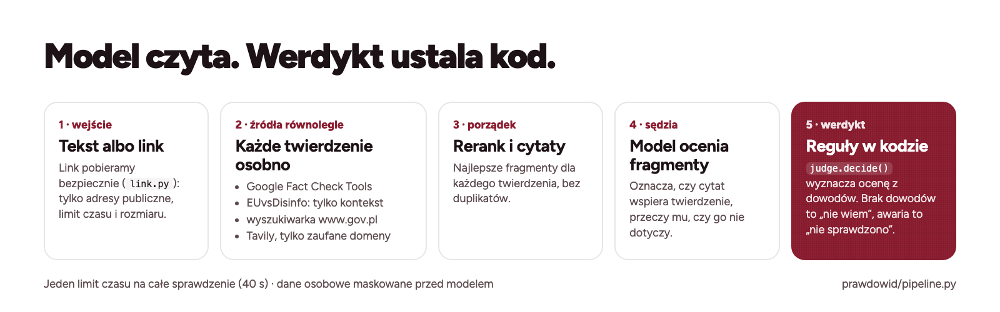

<p align="center">
  
</p>

<p align="center">
  <b><a href="https://faktczyfejk.pl">faktczyfejk.pl</a></b> · HackNation 2026, challenge <b>Prawdowid</b><br>
  Michał Furgała · Łukasz Lenkiewicz · Dominik Galus
</p>

# faktczyfejk

Paste a message or a link you were sent. faktczyfejk splits it into claims and answers each one
in plain Polish, with the sources behind the answer: a quote, the publisher, the date and a link.
When the evidence is not there, it says so instead of guessing.

Run it yourself: [Run](#run) (English) · [Uruchomienie](#uruchomienie) (po polsku).

| One box for text or a link | The answer, claim by claim |
|---|---|
|  |  |

The answer on the right is a real response from the live API on 21.11.2026, taken before Google
Fact Check and EUvsDisinfo were configured on the server and before the outage rule (#60). Today a
claim whose Fact Check or web search is down comes back as `nie sprawdzono` with the outage as the
reason, and an answer where no claim got a verdict for that reason is a technical error. When every
source answered and nothing settles the claim, it is `brak wystarczających dowodów` ("nie udało mi
się potwierdzić") with the reasons listed, not a guess.

## How an answer reads


Answers follow the organiser's sample format: the first words come from the verdict, then the
sources by name. "Skopiuj odpowiedź na czat" copies the same text. A technical failure or a
request to clarify is a grey notice, never a verdict. When Fact Check (its query for the claim
itself, or all of its queries), the whole web search (or gov.pl for a government claim) was down
and the evidence is not enough, the claim is `nie sprawdzono` with the outage as the reason, and
when no claim got a verdict for that reason the whole answer is a technical error ("Nie mogę teraz
sprawdzić ..."). A source that answered with nothing is no outage.

## How it works



- **The model reads, the code decides.** Claude (through PydanticAI) splits the text into claims
  and labels quotes. The verdict comes from rules in `judge.decide()`.
- **Sources per claim, in parallel:** Google Fact Check Tools (fact-checkers' ratings), EUvsDisinfo as context only, the www.gov.pl site search,
  Tavily web search restricted to allowlisted domains, and our evidence corpus (`corpus/evidence.jsonl`), which every check searches.
- **Privacy:** PESEL, ID card, passport, phone, e-mail, account and card numbers are masked before the model. Checks
  are kept for 30 days and can be deleted per session.
- **Two channels, one API:** the web page and the Discord command `/sprawdz` call the same
  `POST /api/checks`. The page `/czat` is a demo adapter of a messenger channel (WhatsApp, Messenger
  and the like): it sends the same request with `X-Channel: demo` and shows the answer as the bot's
  messages, so jurors can try a second channel without Discord. A real messenger would plug into the
  same API.

Measured results live in [`evals/results/HISTORY.md`](evals/results/HISTORY.md), one row per eval
run with its commit and notes. Read [`docs/eval-notes.md`](docs/eval-notes.md) before quoting a number.

## Status in detail

The verifier sends the text to Claude (through PydanticAI) and gets back a list of
claims, each marked checkable or not. The model never decides whether a claim is true. Each
checkable claim then goes through `prawdowid/pipeline.py` in parallel with the others: Google Fact
Check, EUvsDisinfo known narratives (context only, never a verdict on its own), the www.gov.pl site
search (ministry and RCB pages; web search leaves www.gov.pl to it) and web search on
allowlisted domains (our own database, #19, is out of the pipeline for now), then
rerank and a judge that labels quotes; the verdict is set in code (`judge.decide`). The whole check
has one time budget (`PRAWDOWID_CHECK_BUDGET_S`, 40 s). A claim that runs out of time, or whose
sources failed (all of them, or one that could decide the verdict while the rest is not enough),
comes back `not_checked` with the reason, never as a verdict. An
opinion, forecast or question is `not_verifiable`. A link is fetched (`prawdowid/link.py`) and the page's
main text is checked like pasted text; a blocked page, paywall, login wall, social media post,
private address or file that is not HTML or PDF comes back as `cannot_check` with a request to
paste the text. Personal data (PESEL, ID card, passport, phone, e-mail, account and card numbers) is masked before
the text goes to the model. Each check is logged to stdout (session, status, latency, input length)
with a second line for the model call (model, input and output tokens, latency), and kept for 30
days as one masked record in the check log, which the user can delete per session. A link check
also logs the final URL with secret query values removed and personal data masked, the page's
SHA-256, and the text and verdict of every claim. The page text itself is never logged. Successful
web evidence fetches are cached in `corpus/docs.jsonl` as metadata only (full text only once a
domain's licence is confirmed, none today), one record per URL, dropped after 30 days. Details:
[docs/privacy.md](docs/privacy.md), [submission risks](docs/submission/risks.md).

## Configuration

Put these in `.env` in the repository root. The file is git-ignored and is not copied into the
image. `make dev` loads it into the API environment. Compose reads it for interpolation but only
forwards variables declared in `compose.yaml`: the backend gets `ANTHROPIC_API_KEY`,
`PRAWDOWID_MODEL`, `GOOGLE_FACTCHECK_API_KEY`, `TAVILY_API_KEY`, `EUVSDISINFO_API_KEY`,
`PRAWDOWID_GOVPL`, `PRAWDOWID_INCIDENTS_PATH` and `PRAWDOWID_EVAL_TOKEN`, its check log sits on the `checklog` volume (`/var/lib/prawdowid`, kept across
deploys) and its source cache points at a writable `/tmp` path. Other tuning variables need an explicit Compose environment override.

| Variable | Required | Default | What it does |
|---|---|---|---|
| `ANTHROPIC_API_KEY` | yes | none | Anthropic API key. Without it every check returns `technical_error`. |
| `PRAWDOWID_MODEL` | no | `anthropic:claude-sonnet-5-5` | PydanticAI model id (`provider:model`) for claim extraction. Sonnet since 22.11 (same quick-set result as Opus, 18.3 s vs 24.9 s median, $3.96 vs $4.91 per 100 checks, #88). |
| `PRAWDOWID_EVAL_TOKEN` | no | unset | Secret for the eval-only fault switch (`X-Eval-Fault` and `X-Eval-Token` headers, scenario J: `factcheck_api_unavailable`, `llm_unavailable`). Unset: the headers do nothing. Never set it on the public demo. The eval harness reads the same variable. |
| `PRAWDOWID_MAX_CHECKED_CLAIMS` | no | `3` | Claims checked in full per input; the rest are listed as not checked. |
| `PRAWDOWID_CHECK_BUDGET_S` | no | `40` | Time budget for the whole check, in seconds. Claims still running at the end are `not_checked`. |
| `PRAWDOWID_WEB_SEARCH_BUDGET_S` | no | `10` | Longest one web search query may take, retry included, before it counts as unavailable. |
| `PRAWDOWID_PAGE_BUDGET_S` | no | `8` | Longest one page fetch may take (robots.txt and page); a slower web-search page counts only through its search snippet, labelled "fragment z wyników wyszukiwarki" ([docs/sources.md](docs/sources.md)), a slower page from the www.gov.pl site search is skipped; the others are kept. |
| `PRAWDOWID_GOVPL` | no | `1` | `0` switches off the www.gov.pl site search (`prawdowid/govpl.py`); its queries then go to web search, which searches www.gov.pl again. See [docs/sources.md](docs/sources.md). |
| `PRAWDOWID_RETRY_MIN_S` | no | `18` | A claim without enough evidence is searched once more only if at least this many seconds remain. |
| `DISCORD_BOT_TOKEN` | only for the Discord bot | none | Bot token from the Discord developer portal. Without it the bot refuses to start. |
| `PRAWDOWID_API_URL` | no | `http://127.0.0.1:8000` | API the Discord bot calls (`http://backend:8000` in Docker). |
| `GOOGLE_FACTCHECK_API_KEY` | no | none | Google API key with the Fact Check Tools API enabled. Without it the known-claim lookup is reported as unavailable, which counts as an outage: a claim without enough other evidence is then `nie sprawdzono`, not "brak wystarczających dowodów". |
| `TAVILY_API_KEY` | no | none | Tavily API key (`tavily-python`) for web search on allowlisted domains (step 2b). Without it the web search is skipped and reported as unavailable. |
| `DOMAIN` | with `compose.prod.yaml` | none | Public domain Caddy gets the HTTPS certificate for (`compose.prod.yaml`, see `docs/deploy.md`). |
| `POSTGRES_DB`, `POSTGRES_USER`, `POSTGRES_PASSWORD` | with `compose.prod.yaml` | none | Database, user and password of the `db` service. `compose.prod.yaml` passes them to the backend as `DATABASE_URL`. `POSTGRES_PASSWORD` is also the password of the local `sourcedb` service (default `prawdowid`, port bound to 127.0.0.1 only), applied only when its `sourcedb_data` volume is created; see [deletion instructions](docs/sources.md). `make db-seed` refuses until the team approves sources for full-text storage; see [the prerequisite](docs/sources.md#full-text-seed-approval). |
| `DATABASE_URL` | no | none | Postgres URI of the step 2c source store, used only by the seed script (`make db-seed` sets it) and `cache.search_documents`. Step 2c is disabled in the pipeline until licensed sources are chosen, so checks never read or write the database. The backend never needs it; `compose.prod.yaml` sets it for production's separate `db`, which has no source-store schema, so enabling step 2c in production needs this migration applied there first. Start the database with `make db` (127.0.0.1:5433). The corpus search (`prawdowid/corpus_search.py`) reads its own tables (`corpus_documents`, `corpus_chunks`) from the same database; `make index` builds them from `corpus/evidence.jsonl`. |
| `EUVSDISINFO_API_KEY` | no | none | Personal API key for the EUvsDisinfo MCP server (`https://mcp.euvsd.info/mcp`), generated on euvsdisinfo.eu. Sent as the `X-API-Key` header. Without it the EUvsDisinfo lookup is skipped and reported as unavailable. |
| `PRAWDOWID_CHECK_LOG` | no | `logs/checks.jsonl` | Check log file (masked question, result, session id). Docker sets `/var/lib/prawdowid/checks.jsonl` on the `checklog` volume. See [docs/privacy.md](docs/privacy.md). |
| `PRAWDOWID_INCIDENTS_PATH` | no | `prawdowid/data/incidents.json` (empty) | Scenario I incident base, a `.json` or `.csv` file; format in `prawdowid/incidents.py`. Put the file in `incidents/` (git-ignored) and set a path relative to the repository root, e.g. `incidents/base.csv`: `make dev` reads it from the repository, Docker from `/app/incidents/base.csv`, where `compose.yaml` mounts `incidents/` read-only. The file must be readable by every user (the container runs as `nobody`). Read on the first check and kept: restart the backend after changing it. A match is shown next to the claims and never changes a verdict. |
| `PRAWDOWID_EMBEDDING_MODEL` | no | `intfloat/multilingual-e5-large` | Local embedding model for corpus search (fastembed). Changing it rebuilds the index on the next `make index`. |
| `FASTEMBED_CACHE_PATH` | no | fastembed's temp dir | Where the embedding model files are kept (`/models` in the image). |

The extraction call has a 45 s provider request timeout and at most one SDK retry, but shares
the 40 s whole-check deadline with URL fetching and per-claim checks, inside the API's 60 s
limit. Extraction errors and a missing model key return `technical_error`; a
model refusal returns `cannot_check`. Both carry a Polish message and no claims. Retrieval
failures are listed per claim; an outage of a source that could decide the verdict (see above) or a
judge-model outage makes the claim `not_checked`, and the whole answer a `technical_error` when no
claim has a verdict;
a failed retry judgement can retain the first-pass assessment with a warning when first-pass
candidates existed.

## Run

Polska wersja: [Uruchomienie](#uruchomienie).

You need git and Docker with a recent Compose v2 (the frontend build uses `additional_contexts`). Only an Anthropic API key is required; every other key
switches on one more source, and a source without its key is reported as unavailable, never as a
verdict.

1. Clone the repository:

   ```bash
   git clone https://github.com/00200200/HackNation2026.git && cd HackNation2026
   ```

2. Create `.env` in the repository root. The file is git-ignored and never copied into the image:

   ```bash
   ANTHROPIC_API_KEY=sk-ant-...
   # optional, one more source each:
   TAVILY_API_KEY=
   GOOGLE_FACTCHECK_API_KEY=
   EUVSDISINFO_API_KEY=
   ```

   All variables are listed in [Configuration](#configuration). Every check calls three models by
   default: `claude-sonnet-5-5` for extraction and the judge, `claude-haiku-5-5` for rerank
   (`PRAWDOWID_MODEL`, `PRAWDOWID_JUDGE_MODEL`, `PRAWDOWID_RERANK_MODEL`); whether your account can
   use them is UNCONFIRMED. Without a working key the page
   opens, but every check returns a technical notice.

3. Build and start the stack (web page, API):

   ```bash
   make up
   ```

   Open http://localhost:8080. The API docs are at http://localhost:8080/api/docs and
   `curl http://localhost:8080/health` returns `{"status":"ok"}`. Another port: `make up PORT=9000`.
   Without `make`: `docker compose up --build -d`.

4. Stop it with `make down`. Logs: `make logs`.

The check log is kept on the `checklog` volume (`/var/lib/prawdowid/checks.jsonl`), so it
survives a redeploy; the source cache sits in `/tmp/prawdowid` inside the container.

**Discord bot.** Set `DISCORD_BOT_TOKEN` in `.env`, install the application in your Discord
server with slash-command access, then run `make up DISCORD=1` and use `/sprawdz tekst:`. Live
Discord transport has not been verified in the saved eval; a token alone does not prove the bot
is installed.

**API without Docker.** Install [uv](https://docs.astral.sh/uv/getting-started/installation/),
then run `make install` and `make dev`. The API listens on http://127.0.0.1:8000 (docs at
`/api/docs`); `make dev` loads `.env`, plain `uvicorn` does not. This path serves no web page; send a check with:

```bash
curl -s -X POST http://127.0.0.1:8000/api/checks -H 'Content-Type: application/json' -d '{"input": "Tekst do sprawdzenia"}'
```

In another terminal `make discord` runs the bot against this API. PostgreSQL is optional and
not used by checks; do not seed it until source permissions are confirmed.

**Tests and eval.** `make check` runs ruff and pytest. With `make dev` running,
`PRAWDOWID_URL=http://127.0.0.1:8000 uv run python -m evals.run --quick` runs one eval case per
scenario (needs the keys). The eval does not read `.env`: export `PRAWDOWID_EVAL_TOKEN` (also set
in `.env` for `make dev`) and `PRAWDOWID_FIXTURE_BASE` in its shell, or the fault and page-fixture
cases are skipped with a warning. See [Pre-push gate](#pre-push-gate).

**Public deployment** with HTTPS on a server: [docs/deploy.md](docs/deploy.md).

Run `make help` to list every target. The ones used most:

| Target | What it does |
|---|---|
| `make up` / `make down` / `make logs` | Docker stack: frontend on `PORT` (default 8080), backend internal only |
| `make dev` | API alone on http://127.0.0.1:8000 with reload (docs at `/api/docs`) |
| `make discord` | Discord bot against `make dev`; `make up DISCORD=1` runs it in Docker |
| `make check` | `ruff format --check`, `ruff check`, `pytest` |
| `make format` | Format and autofix |
| `make openapi` | Regenerate `docs/openapi.json` from the app |
| `make corpus` / `make corpus-check` | Rebuild the evidence corpus from its source catalogue / check it against the brief's thresholds |
| `make index` | Load `corpus/evidence.jsonl` into Postgres for search (needs `DATABASE_URL`) |

## Uruchomienie

English version: [Run](#run).

Potrzebujesz gita i Dockera z aktualnym Compose v2 (budowanie strony używa `additional_contexts`). Wymagany jest tylko klucz API Anthropic. Każdy kolejny
klucz włącza jedno źródło więcej; źródło bez klucza jest zgłaszane jako niedostępne, nigdy jako
werdykt.

1. Sklonuj repozytorium:

   ```bash
   git clone https://github.com/00200200/HackNation2026.git && cd HackNation2026
   ```

2. Utwórz plik `.env` w katalogu głównym repozytorium. Plik jest ignorowany przez gita i nie trafia do obrazu:

   ```bash
   ANTHROPIC_API_KEY=sk-ant-...
   # opcjonalne klucze, każdy włącza jedno źródło:
   TAVILY_API_KEY=
   GOOGLE_FACTCHECK_API_KEY=
   EUVSDISINFO_API_KEY=
   ```

   Wszystkie zmienne są w sekcji [Configuration](#configuration). Każde sprawdzenie domyślnie
   korzysta z trzech modeli: `claude-sonnet-5-5` do wydzielania twierdzeń i oceny, `claude-haiku-5-5`
   do rerankingu (`PRAWDOWID_MODEL`, `PRAWDOWID_JUDGE_MODEL`, `PRAWDOWID_RERANK_MODEL`); dostęp
   Twojego konta do nich jest NIEPOTWIERDZONY. Bez działającego
   klucza strona się otworzy, ale każde sprawdzenie skończy się komunikatem o błędzie technicznym.

3. Zbuduj i uruchom kontenery (strona i API):

   ```bash
   make up
   ```

   Otwórz http://localhost:8080. Dokumentacja API jest pod http://localhost:8080/api/docs, a
   `curl http://localhost:8080/health` zwraca `{"status":"ok"}`. Inny port: `make up PORT=9000`.
   Bez `make`: `docker compose up --build -d`.

4. Zatrzymaj go poleceniem `make down`. Logi: `make logs`.

Dziennik sprawdzeń leży na wolumenie `checklog` (`/var/lib/prawdowid/checks.jsonl`), więc
przetrwa ponowne wdrożenie; pamięć podręczna źródeł jest w `/tmp/prawdowid` w kontenerze.

**Bot na Discordzie.** Ustaw `DISCORD_BOT_TOKEN` w `.env`, dodaj aplikację do swojego serwera
Discord z uprawnieniem do poleceń z ukośnikiem, uruchom `make up DISCORD=1` i użyj
`/sprawdz tekst:`. Zapisany eval nie obejmuje działania bota na prawdziwym Discordzie; sam token
nie dowodzi, że bot jest zainstalowany.

**API bez Dockera.** Zainstaluj [uv](https://docs.astral.sh/uv/getting-started/installation/),
potem uruchom `make install` i `make dev`. API działa pod http://127.0.0.1:8000 (dokumentacja pod
`/api/docs`); `make dev` wczytuje `.env`, samo `uvicorn` już nie. Ta ścieżka nie serwuje strony; sprawdzenie wyślesz tak:

```bash
curl -s -X POST http://127.0.0.1:8000/api/checks -H 'Content-Type: application/json' -d '{"input": "Tekst do sprawdzenia"}'
```

W drugim terminalu `make discord` uruchamia bota podłączonego do tego API. PostgreSQL jest opcjonalny i
sprawdzenia z niego nie korzystają; nie zasilaj go danymi, dopóki nie mamy potwierdzonych zgód źródeł.

**Testy i eval.** `make check` uruchamia ruff i pytest. Przy działającym `make dev`
`PRAWDOWID_URL=http://127.0.0.1:8000 uv run python -m evals.run --quick` uruchamia po jednym
przypadku testowym na scenariusz (potrzebne klucze). Eval nie czyta `.env`: wyeksportuj w jego
powłoce `PRAWDOWID_EVAL_TOKEN` (ustawiony też w `.env` dla `make dev`) i `PRAWDOWID_FIXTURE_BASE`,
inaczej przypadki awarii i stron testowych zostaną pominięte z ostrzeżeniem. Zob. [Pre-push gate](#pre-push-gate).

**Wdrożenie publiczne** z HTTPS na serwerze: [docs/deploy.md](docs/deploy.md).

`make help` wypisuje wszystkie cele. Najczęściej używane:

| Cel | Co robi |
|---|---|
| `make up` / `make down` / `make logs` | Kontenery w Dockerze: strona na porcie `PORT` (domyślnie 8080), backend tylko wewnątrz |
| `make dev` | Samo API pod http://127.0.0.1:8000 z przeładowaniem (dokumentacja pod `/api/docs`) |
| `make discord` | Bot na Discordzie podłączony do API z `make dev`; `make up DISCORD=1` uruchamia go w Dockerze |
| `make check` | `ruff format --check`, `ruff check`, `pytest` |
| `make format` | Formatowanie i automatyczne poprawki |
| `make openapi` | Generuje na nowo `docs/openapi.json` z aplikacji |
| `make corpus` / `make corpus-check` | Buduje korpus dowodów z katalogu źródeł / sprawdza go względem progów z briefu |
| `make index` | Ładuje `corpus/evidence.jsonl` do Postgresa do wyszukiwania (wymaga `DATABASE_URL`) |

## Architecture board

The team's architecture whiteboard: https://claude.ai/artifact/W9KUaX37YHjRFjAzZedyvs

## Layout

- `frontend/`: static `index.html` (the check) and `zrodla.html` (the source list, from
  `GET /api/sources`), with `styles.css`, `common.js`, `app.js` and `zrodla.js` (no build step), served by nginx.
  `czat.html`, `czat.js` and `czat.css` are the messenger demo adapter at `/czat` (#116): the same
  `POST /api/checks` with `X-Channel: demo`, the reply in the sections and order of the Discord bot's
  message plus the web page's first words (`tests/test_czat.py` keeps the wording in step).
  nginx also proxies `/api/` and `/health` to the backend, caps request bodies at 64 KB and sets
  a strict Content-Security-Policy (wider only for `/api/docs`, which loads Swagger UI from
  cdn.jsdelivr.net).
- `Dockerfile`: the backend image (Python 3.13, uv, runs as `nobody`).
- `compose.yaml`: both services. Only the frontend port is published.
- `compose.prod.yaml`, `caddy/Caddyfile`: production overlay. Caddy serves HTTPS in front of nginx
  and is then the only service with published ports; `db` is Postgres 18 with pgvector and pg_trgm.
- `deploy/`: the server's deploy script and systemd timer. The demo server picks up a push to the
  `prod` branch within about a minute and then builds and starts it; setup in `docs/deploy.md`.
- `prawdowid/contract.py`: `Verdict`, `Status`, `Source`, `ClaimResult`, `CheckResult` (with `page`,
  `security_events`, `cost_usd`).
- `prawdowid/privacy.py`: `mask_personal_data` and `RETENTION_DAYS`; `prawdowid/checklog.py`: the check log
  per demo session (`DELETE /api/sessions/{id}` removes a session).
- `prawdowid/link.py`: `fetch_page(url)`, the guarded fetch and text extraction for link input.
- `prawdowid/verifier.py`: `async def verify(text) -> CheckResult`, the one function every
  channel calls. Holds the PydanticAI agent, its prompt and `to_check_result`, the pure function
  that turns the model's claims into verdicts.
- `prawdowid/factcheck.py`: `search_keys(claim, keys)`, the known-claim lookup in Google Fact
  Check Tools (`claims:search`). `keys_for` gives each claim several short keys (the claim, the
  names in it, quoted spans of the claim or its source sentence, its search queries; masked again,
  at most `PRAWDOWID_FACTCHECK_MAX_KEYS`, 8), sent at once and merged by review URL, at most 10
  reviews. Each review becomes a `Source` (`source_type="fact_check"`) whose fragment carries the
  fact-checker's rating and the reviewed claim as data for the judge. A rating sets the verdict
  only for a review of the checked claim itself (`judge.RATINGS`, ADR 0001); a review of another
  claim is context. One retry on a network error or 5xx, 15 s deadline per key. A missing key,
  4xx (bad key, quota) or outage of a key is a `limitation`; Fact Check counts as down when the
  claim's own key or every key failed. Called per claim from `prawdowid/pipeline.py` (#11, #100).
- `prawdowid/corpus_bm25.py`: `search_evidence(queries)`, the corpus lookup of every check, in step 2
  next to Fact Check, EUvsDisinfo, gov.pl and web search. BM25 in memory over
  `corpus/evidence.jsonl` (`bm25s`, numpy only): no database, no embedding model, no network. The
  API builds the index at startup (0.7 s on a laptop, 1,158 records; a lookup that comes first
  builds it); a lookup takes about a millisecond. Words are lowercased, stripped of diacritics and cut to five letters,
  stopwords dropped. The claim and each of its queries are ranked on their own and merged by
  reciprocal rank fusion: at most 5 documents, 2 passages of each. A hit is a `Source` with the
  record's publisher, publication date and retrieval date, and a `fragment` that is a verbatim
  part of the document, so the judge's quote check works as for any other source. A missing or
  unreadable file returns a `limitation`; a line that is no record is skipped. When every outside source fails, corpus hits count only
  if the judge settles the claim on them; otherwise the claim is `nie sprawdzono`. Try it:
  `uv run python -m prawdowid.corpus_bm25 "czy MSZ odradza podróże do Izraela"`.
- `prawdowid/corpus_search.py`: `search_corpus(query)`, hybrid search in the evidence corpus
  (pgvector nearest chunks and Postgres full-text, merged by reciprocal rank fusion, at most two
  chunks per document). Each hit is a `Source` whose `fragment` is a verbatim chunk of the stored
  document, plus the fact-checker's rating and reviewed claim for fact-checks. 10 s deadline; no
  database or an error returns a `limitation`. Checks do not call it, they use `corpus_bm25.py`.
  `prawdowid/index.py` builds the tables (`make index`), `prawdowid/embeddings.py` holds the
  local embedding model.
- `prawdowid/app.py`: the API, input validation, rate limit, the `technical_error` path and the
  OpenAPI docs (`docs/openapi.json` is its committed spec).
- `prawdowid/discord_bot.py`: the second channel, a `/sprawdz tekst:` slash command (discord.py).
  It sends the same `POST /api/checks` as the web form, with `X-Channel: discord`, and renders the
  `CheckResult` with the same sections (verdict, reasoning, strength, premises, sources with
  quotes, limitations). User and source text is escaped and messages never ping anyone. An answer
  goes out in at most 5 messages of 2000 characters; whatever does not fit is in an attached
  `odpowiedz.md` with the whole answer. API errors are shown as notices.
  The bot shares one API rate limit (10 per minute) for all its users.
- `corpus/`: the evidence corpus. `catalog.yaml` is the audited source list with its rules,
  `evidence.jsonl` the collected records, `manifest.json` the last build, `build.py` and `sources/`
  the collectors. Sources, licences and limits: [`docs/corpus.md`](docs/corpus.md).

## API

| Method and path | What it does |
|---|---|
| `POST /api/checks` | Body `{"input": "..."}`. Returns `CheckResult`. 60 s timeout on `verify`; 10 requests per minute per client IP. |
| `GET /api/openapi.json` | The OpenAPI spec. |
| `GET /api/docs` | Interactive docs (Swagger UI) for the spec. |
| `GET /health` | Liveness. |

**Adding a channel.** The spec is the contract: https://faktczyfejk.pl/api/openapi.json, with
interactive docs at https://faktczyfejk.pl/api/docs, and a copy in
[`docs/openapi.json`](docs/openapi.json) that needs no running server. After an API change
run `make openapi`; a test fails while the copy is stale. A channel sends `POST /api/checks`
with `X-Channel: <its name>` (a name missing from `CHANNELS` in `prawdowid/app.py` is logged
as `other`) and, to keep its checks together, the `X-Session-Id` it got back. The Discord bot
([`prawdowid/discord_bot.py`](prawdowid/discord_bot.py)) sends `X-Channel: discord`, the demo
adapter at `/czat` ([`frontend/public/czat.js`](frontend/public/czat.js)) `X-Channel: demo`; the web
page ([`frontend/public/app.js`](frontend/public/app.js)) sends the session id back.

Input is trimmed and must be 1 to 5000 characters. A single token containing `://` counts as a
link and must be a valid `http` or `https` URL. The page is fetched only from public addresses
(checked on every connection, so redirects and DNS cannot reach private, loopback or link-local
hosts), with at most 3 redirects (their bodies are never read), a 10 s deadline and a 2 MB cap.
The URL policy (scheme, social media hosts, login pages) is applied before every hop. HTML goes
through trafilatura and PDF through pypdf in a child process (`prawdowid/extract_worker.py`) that
is killed at the deadline; at most 2 run at once per API process. The parsers stop after 50 PDF
pages, 20,000 characters and 20 MB decompressed per stream; on Linux the child is also capped at
1 GB of memory and 15 s of CPU. Title, publisher, date and text together are cut to 5000
characters for the verifier. `CheckResult.page` carries the
page URL, content hash, title, publisher and date, never the page text. An `input` that is
empty, too long or not a valid link comes back as 422 with a Polish message in `detail[0].msg`.

`ClaimResult` carries `verdict_label`, the Polish label for its verdict, so channels do not keep
their own copy of the labels.

## Submission drafts

Submission drafts: [description](docs/submission/description.md),
[architecture and exact test results](docs/submission/architecture.md),
[sources](docs/submission/sources.md), [risks](docs/submission/risks.md),
[cost](docs/submission/cost.md), [Polish slide outline](docs/submission/slides-outline.md).
The PDF and demo video remain open human work under [#18](https://github.com/00200200/HackNation2026/issues/18).

## Pre-push gate

Run once per clone:

```bash
git config core.hooksPath .githooks
```

`.githooks/pre-push` refuses a push without a `judge` agent PASS for the pushed commit, and on secrets, tracked
`.env` files, files over 10 MB, or failing ruff or pytest. Once an eval has run in the clone, product changes also
need a clean eval run on the pushed commit (`uv run python -m evals.run --quick`). Eval runs print one line per
finished case and take `--concurrency N`, `--resume`, `--retry-failed`, `--only` and `--note` (see the prawdowid-eval
skill). The submission push is
`HN_FINAL=1 git push`. Rules: `.claude/skills/hacknation-judging/SKILL.md` and `.claude/skills/prawdowid-eval/SKILL.md`.

Every eval run is logged in [`evals/results/HISTORY.md`](evals/results/HISTORY.md) (one row per run, full JSON
under `evals/results/history/`), not only `evals/results/latest.json`. Read
[`docs/eval-notes.md`](docs/eval-notes.md) first: it explains why some past runs are distorted. **Rule: check the
commit and the notes column before concluding anything from a number.**
