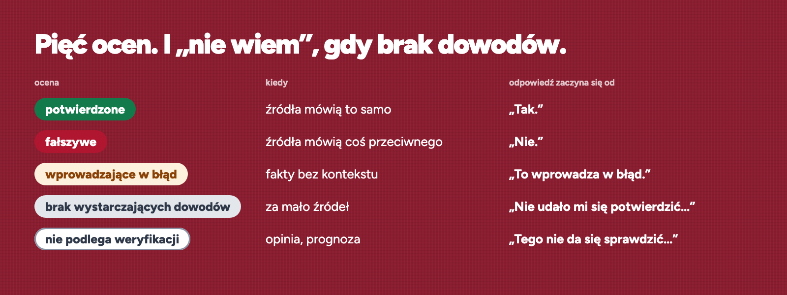

<p align="center">
  
</p>

<p align="center">
  <b><a href="https://faktczyfejk.pl">faktczyfejk.pl</a></b> · HackNation 2026, challenge <b>Prawdowid</b><br>
  Michał Furgała · Łukasz Lenkiewicz · Dominik Galus
</p>

# faktczyfejk

Paste a message or a link you were sent. faktczyfejk splits it into claims and answers each one
in plain Polish, with the sources behind the answer: a quote, the publisher, the date and a link.
When the evidence is not there, it says so instead of guessing.

| One box for text or a link | The answer, claim by claim |
|---|---|
|  |  |

The answer on the right is a real response from the live API (21.11.2026). Google Fact Check and
EUvsDisinfo were not configured on the server yet and web search found nothing, so both claims come
back as `brak wystarczających dowodów` ("nie udało mi się potwierdzić") with the reasons listed,
not as a guess.

## How an answer reads



Answers follow the organiser's sample format: the first words come from the verdict, then the
sources by name. "Skopiuj odpowiedź na czat" copies the same text. A technical failure or a
request to clarify is a grey notice, never a verdict, and a claim whose sources all failed comes
back as `nie sprawdzono` with the reason.

## How it works


- **The model reads, the code decides.** Claude (through PydanticAI) splits the text into claims
  and labels quotes. The verdict comes from rules in `judge.decide()`.
- **Sources per claim, in parallel:** Google Fact Check Tools (fact-checkers' ratings), EUvsDisinfo as context only, the www.gov.pl site search, and
  Tavily web search restricted to allowlisted domains.
- **Privacy:** PESEL, phone, e-mail, account and card numbers are masked before the model. Checks
  are kept for 30 days and can be deleted per session.
- **Two channels, one API:** the web page and the Discord command `/sprawdz` call the same
  `POST /api/checks`.

Measured results live in [`evals/results/HISTORY.md`](evals/results/HISTORY.md), one row per eval
run with its commit and notes. Read [`docs/eval-notes.md`](docs/eval-notes.md) before quoting a number.

## Zgodność z wymaganiami

Wymagania pochodzą z opisu zadania Prawdowid (MSZ), sekcje 3 do 6. Tabele opisują kod, a nie żywą stronę, w stanie z 22.11.2026: `main` (`1aa173f`) plus zmiany z następnej sekcji, które czekają na scalenie. Główna z nich to PR #126 (gałąź `integration/r3`, głowa `ca48b84` z 22.11.2026, 03:12, otwarty): zawiera PR #109 (`2e0f8ce`) i zastępuje go oraz PR #97, #98, #99, #111 i #72. Wiersze opisują głowę PR #126, więc po nowych commitach w tym PR trzeba je sprawdzić ponownie. Strona https://faktczyfejk.pl działa z gałęzi `prod`, która bierze tylko commity z `main` ([WORKLOG.md](WORKLOG.md)), więc te zmiany trafią na nią po scaleniu i wdrożeniu; co jest wdrożone dziś, tu nie sprawdzono. Gdzie wiersz zależy od takiej zmiany, stoi jej numer. Poza tą sekcją README opisuje `main` (budżet 25 s, Opus i dziennik w `/tmp` zmieniają się razem z tymi zmianami). "Zrobione" znaczy, że działa w kodzie i ma test albo pomiar. "Częściowo" znaczy, że działa z nazwanym brakiem. "Brak" znaczy, że tego nie ma. Przy zakazach "zrobione" znaczy, że kod ich przestrzega. Numery w nawiasach to zgłoszenia w repozytorium. Czego system nie obsługuje i jaki komunikat widzi wtedy użytkownik: [docs/unsupported.md](docs/unsupported.md).

### Zmiany czekające na scalenie

Build demo to `main` plus zmiany z tabeli. Kolumna "Na `main`" mówi, jak zachowuje się kod, dopóki zmiana nie zostanie scalona. Po scaleniu ta sekcja traci sens: trzeba ją usunąć razem z odwołaniami do PR w tabelach poniżej ([WORKLOG.md](WORKLOG.md)).

| Zmiana | Zadania | Gdzie | Na `main` |
|---|---|---|---|
| Awaria źródła, które mogło rozstrzygnąć, nie jest werdyktem: `nie sprawdzono`, a gdy tak jest przy każdym sprawdzalnym twierdzeniu, `technical_error`. Budżet sprawdzenia 40 s, trzy twierdzenia, dziennik na wolumenie | [#60], [#63], [#70] | [PR #126] | Gdy część źródeł zawiodła, a reszta nic nie znalazła: `brak wystarczających dowodów`. Budżet 25 s, pięć twierdzeń, dziennik ginie przy wdrożeniu |
| Korpus przeszukiwany w każdym sprawdzeniu (BM25 w pamięci) | [#74] | [PR #126] | Korpus nie jest przeszukiwany |
| Źródła sprawdzane pod kątem wstrzykniętych instrukcji, odporność liczona osobno od werdyktu, ocena fact-checkera dla sędziego, uzasadnienie z dowodów | [#61], [#62], [#66], [#68] | [PR #126] | Reranker i model sędziego czytają źródła, a wstrzyknięcie w źródle może zgłosić tylko sędzia (zdarzenie z `detector=model`); kod źródeł nie przeszukuje; odporność liczona razem z werdyktem, tytuł recenzji bez oceny może przesądzić werdykt, uzasadnienie bywa powodem sprawdzalności |
| Wspólna pamięć wyników dla obu kanałów (30 minut) | [#59] | [PR #126] | Brak, każde sprawdzenie liczy się od nowa |
| Maskowanie numeru dowodu, numeru paszportu i dodatkowych formatów telefonu | [#82] | [PR #126] | Telefon tylko w formatach `+48 600 100 200` i `600-100-200`, brak dowodu i paszportu |
| Specyfikacja OpenAPI i dokumentacja pod `/api/` | [#87] | [PR #126] | Według zgłoszenia 404 na publicznym demo (tego nie sprawdzaliśmy) |
| Pamięć podręczna wyników Tavily, fragmenty z wyszukiwarki dla stron, których serwer nie może pobrać, strony bez daty, 18 domen na liście, Sonnet jako domyślny model ekstrakcji, przypadki eval E07 do E15 | [#110], [#95], [#76], [#88], [#94] | [PR #126] | Brak pamięci podręcznej, 15 domen, Opus |
| Publiczna strona `/zrodla` ze źródłami (`GET /api/sources`) | [#83] | [PR #126] | Brak |
| Fact Check pytany kilkoma krótkimi kluczami na twierdzenie (twierdzenie, nazwy, cytowane fragmenty, zapytania), ocena fact-checkera tego samego twierdzenia daje werdykt według tabeli w kodzie (`judge.RATINGS`) i jest pokazana jako ocena, nie cytat ze strony | [#100] | [PR #126] | Jedno zapytanie z całym twierdzeniem, ocena `textualRating` jest tylko sygnałem obok źródła, bez mapowania na werdykt w kodzie |
| Tekst korpusu maskowany przy budowie, `make corpus-check` zgłasza numer telefonu i inne dane, które maskowanie jeszcze by zmieniło | [#113] | [PR #126] | Rekord `gus-ca9942c072` ma numer telefonu osoby podanej z nazwiskiem, a `make corpus-check` go nie wykrywa |
| Wyjątki w maskowaniu tekstu użytkownika: numer karty zostaje po etykiecie produktu (w tym `nr`, `numer`, `id`), w adresie URL i jako EAN-13, dziewięć cyfr zostaje, gdy wygląda na kwotę lub identyfikator | [#113] | [PR #126] | Każdy numer karty z poprawną sumą Luhna jest maskowany, także po `nr` |
| Strona `/czat`: adapter demonstracyjny w stylu komunikatora, ten sam `POST /api/checks` z `X-Channel: demo` | [#116] | [PR #126] | Brak. Jedyny drugi kanał to bot Discord, który według [#59] nie jest wdrożony (tego nie sprawdzaliśmy) |
| Bot Discord na serwerze demo | [#59] | [PR #73] | Według zgłoszenia bot nie działa na serwerze demo (tego nie sprawdzaliśmy) |

PR #126 zawiera też poprawki harnessu eval ([#101], [#102]: nagłówek `X-Eval-Fault-Applied` potwierdza zastosowanie symulowanej awarii, błędy harnessu nie liczą się do metryk, koszt jest zawsze liczbą z osobnym licznikiem niewycenionych żądań), kontrolę wycieku przypadków eval do kodu produktu ([#91]) i materiały zgłoszenia ([#18]: opis i 12 stron w `docs/pitch/`). Wiersze metryk mówią, co z tego wynika dla pomiaru.

### Minimalny zakres (sekcja 3)

| Wymaganie | Stan | Dowód i uwagi |
|---|---|---|
| Wejście: tekst przez responsywny interfejs WWW | częściowo | Strona w `frontend/` (nginx) wywołuje `POST /api/checks` z `prawdowid/app.py`. Długość wejścia jest walidowana, limit to 5000 znaków. Testy obejmują API (`tests/test_app.py`), a strony nie: testu frontendu ani sprawdzenia widoku na wąskim ekranie w repozytorium nie ma. |
| Wejście: adres URL | częściowo | `prawdowid/link.py` pobiera stronę (HTML i PDF, ochrona przed SSRF), a jej tekst idzie przez to samo `verify()`. Zestaw przypadków na `main` (73) nie ma żadnego wejścia z adresem. W PR #109 jest ich 4 z 77: U01 (długa strona gov.pl) i U02 (policja.pl), oba z [#63], oraz E05 i E06 (strony testowe z wstrzykniętą treścią), a w PR #126 13 z 86, bo dochodzą E07 do E15. W pełnym przebiegu `ca48b84` poszły dwa przypadki z adresem, U01 i U02: oba z odpowiedzią `ok` w progu 30 s (28.5 s i 27.8 s), pierwsze twierdzenie U01 dostało `brak wystarczających dowodów`, a U02 `potwierdzone`. E05 do E15 pominięto z braku publicznego adresu stron testowych. Zgłoszenie [#63] opisuje obserwację na żywo z 21.11, której nie odtworzono w repozytorium: długa strona zużywała budżet 25 s i twierdzenia wracały jako `nie sprawdzono`. Build demo ma budżet 40 s i trzy twierdzenia na sprawdzenie. |
| Drugi kanał albo adapter demonstracyjny | częściowo | Komenda Discord `/sprawdz` (`prawdowid/discord_bot.py`) woła to samo `POST /api/checks` z nagłówkiem `X-Channel: discord` i ma testy (`tests/test_discord_bot.py`). Według [#59] bot nie jest wdrożony, więc jury nie uruchomi go na naszym serwerze (tego nie sprawdzaliśmy, [PR #73]). Strona `/czat` (adapter demonstracyjny w stylu komunikatora, ten sam `POST /api/checks` z `X-Channel: demo`, [#116]) jest w PR #126; na `main` jej nie ma, więc do scalenia i wdrożenia jury jej nie otworzy. |
| Rozpoznanie jednego lub kilku twierdzeń | zrobione | Model dzieli tekst na twierdzenia i oznacza sprawdzalne (`prawdowid/verifier.py`). Werdykt dostaje do 3 z nich (`PRAWDOWID_MAX_CHECKED_CLAIMS`, na `main` 5, [#63]), reszta trafia na listę bez werdyktu. |
| Wyszukiwanie w opisanym zbiorze, co najmniej dwa typy źródeł, pokazanie użytych materiałów | częściowo | Na każde twierdzenie: Google Fact Check (w PR #126 kilkoma krótkimi kluczami, [#100]), wyszukiwarka www.gov.pl, Tavily na liście 18 domen (`prawdowid/websearch.py`, 15 na `main`), nasz korpus (1158 rekordów, BM25 w pamięci, `prawdowid/corpus_bm25.py`, [#74]) i EUvsDisinfo (samo trafienie nie wystarcza do werdyktu). Źródło ma tytuł, wydawcę, datę, link i cytat, a przy recenzji fact-checkera zamiast cytatu jego ocenę z rekordu ClaimReview, pokazaną jako ocena (od [#100], PR #126). Strona, której serwer nie może pobrać (403, 429, brak odpowiedzi w czasie), zostaje jako fragment z wyników wyszukiwarki z etykietą, a strona bez daty z ostrzeżeniem ([#95], [#76]). Według [#95] na `main` pobieranie gubi większość znalezionych stron (tego w repozytorium nie odtworzono). Publiczna lista źródeł (strona `/zrodla`, `GET /api/sources`, [#83]) jest w PR #126, na `main` jej nie ma. |
| Wynik, krótkie uzasadnienie, siła podstawy, ograniczenia | częściowo | `ClaimResult` (`prawdowid/contract.py`) ma werdykt, uzasadnienie, siłę, przesłanki, źródła i ograniczenia. Uzasadnienie powstaje w kodzie z dowodów, na których stoi werdykt (`prawdowid/justification.py`, [#68]; na `main` pokazuje czasem powód sprawdzalności). Siła `silna` wymaga co najmniej dwóch niezależnych źródeł, w tym wiarygodnego. Od [#95] (PR #126) to wiarygodne źródło musi też być przeczytane przez nas, a nie znane tylko z fragmentu w wyszukiwarce, i mieć datę publikacji. Wiek dowodu nie zmienia siły, a po 730 dniach tylko dodaje ostrzeżenie o archiwaliach ([#67]). |
| Odpowiedź po polsku, prostym językiem | częściowo | Etykiety, komunikaty i odpowiedzi są po polsku, strona ma `lang="pl"`. Czytelności nie mierzyliśmy, a porównanie z przykładowymi odpowiedziami mentora jest otwarte ([#92]). |
| Zapis przebiegu: pytanie, czas, źródła, wynik | częściowo | `prawdowid/checklog.py` zapisuje zamaskowane pytanie, czas, kanał, status, czasy kroków, wywołania modeli, koszt oraz werdykt i źródła każdego twierdzenia. Wolumen `checklog` w `compose.yaml` ma zachować dziennik przy wdrożeniu ([#70]); na serwerze tego jeszcze nie sprawdzono, a na `main` dziennik ginie przy każdym wdrożeniu. |
| Wstrzymanie się bez dowodów | zrobione | `judge.decide()` (kod, nie model) zwraca `brak wystarczających dowodów`, gdy żadna strona nie ma zweryfikowanego cytatu z wystarczająco mocnego źródła (`prawdowid/judge.py`). Testy: `tests/test_judge.py`, na przykład `test_single_weak_source_is_insufficient`. Pomiar: pełny przebieg `ca48b84`, 0.917 (11 z 12 przypadków; tabela metryk). |
| Pełna ścieżka bez ręcznej ingerencji | częściowo | W kodzie nie ma kroku ręcznego między zgłoszeniem a zapisem w dzienniku. Pełny przebieg `ca48b84` zaliczył 73 z 75 przypadków pod względem statusu odpowiedzi (tabela metryk), co nie sprawdza poprawności werdyktu. Niezaliczone są J01 (symulowana awaria Fact Check, [#101]) i A15 (`needs_clarification` zamiast odpowiedzi `ok`). |

### Funkcje premiowane

| Funkcja | Stan | Dowód i uwagi |
|---|---|---|
| Obraz i dźwięk: OCR, transkrypcja, metadane, porównywanie obrazów | brak | Wejście to tekst i adres URL. Zrzut ekranu: [#80]. Nie deklarujemy wyszukiwania odwrotnego obrazu. |
| Porównywanie źródeł, łańcuch dowodowy | częściowo | Sędzia oznacza każdy fragment jako potwierdzający, obalający, kontekst albo lukę i podaje dokładny cytat (`prawdowid/judge.py`). Odpowiedź nie pokazuje tego stanowiska przy źródle ([#78]). |
| Wielojęzyczne wyszukiwanie, odpowiedź po polsku | brak | Zapytania są po polsku. Angielskie zapytania do EUvsDisinfo i źródeł międzynarodowych: [#89]. |
| Otwarty lub wymienny katalog źródeł z zasadami | częściowo | Katalog `corpus/catalog.yaml`, zasady włączania, aktualizacji i wykluczania oraz licencje w [docs/corpus.md](docs/corpus.md) i [docs/sources.md](docs/sources.md). Odświeżanie jest ręczne ([#90]), a publiczna strona `/zrodla` ze źródłami jest w PR #126 ([#83]), na `main` jej nie ma. |
| Podłączanie kanałów, modeli i źródeł bez przebudowy | częściowo | Kanały wołają to samo API, modele wybierają trzy zmienne środowiskowe (PydanticAI, ale `compose.yaml` przekazuje dziś do kontenera tylko `PRAWDOWID_MODEL`), a źródła zwracają wspólny `Source`. Podmiana na model spoza Claude nie była uruchomiona, a zainstalowany jest tylko dodatek `anthropic` (szczegóły w [docs/privacy.md](docs/privacy.md#where-data-is-processed)). |
| Dopasowanie do katalogu incydentów albo korpusu | częściowo | `prawdowid/incidents.py` dopasowuje wejście po adresie, domenie i podobieństwie tekstu i nigdy nie ustawia werdyktu. Baza incydentów organizatora nie jest wczytana, więc moduł jest pusty ([#64]). Korpus jest przeszukiwany w każdym sprawdzeniu jako źródło ([#74]), nie jako dopasowanie do incydentów. |
| Eksport danych, integracje analityczne | częściowo | JSON z `POST /api/checks` i `GET /api/sessions/{id}`. CSV i STIX dla OpenCTI: brak ([#86]). W PR #126 specyfikacja OpenAPI jest pod `/api/openapi.json`, dokumentacja interaktywna pod `/api/docs`, a kopia w `docs/openapi.json` ([#87]; według zgłoszenia na `main` zwracało to 404 na publicznym demo, czego nie sprawdzaliśmy). |
| Kontrolowana archiwizacja materiału wskazanego przez użytkownika | brak | Nic nie jest archiwizowane na prośbę użytkownika. Dziennik sprawdzeń trzyma skrót SHA-256 strony, nie jej treść. |
| Mniejsza zależność od dostawców spoza EOG, audyt, hosting własny, miejsce przetwarzania | częściowo | Serwer to OVHcloud VPS w Limburgu (DE), całość uruchamia Docker Compose z kodu z repozytorium. Dostawcy modeli i wyszukiwania działają poza naszą kontrolą: tabela dostawców i droga migracji w [docs/privacy.md](docs/privacy.md#where-data-is-processed). Przebiegu na modelu przetwarzanym w UE nie wykonano ([#85]). |
| Pętla informacji: sprawa moderatora, grupowanie podobnych zgłoszeń | brak | Nie zbudowana ([#79]). Eval pokazuje 0.0. |

### Wymagania formalne (sekcja 4)

| Wymaganie | Stan | Gdzie |
|---|---|---|
| Nazwa zespołu, tytuł, opis do 4000 znaków | częściowo | Szkic: [docs/submission/description.md](docs/submission/description.md). Na `main` ma 2309 znaków, nazwę zespołu jako placeholder TEAM_NAME i nadal pisze, że nie zbudowaliśmy korpusu, który już jest. W PR #126 opis ma 3921 znaków z limitu 4000 i opisuje korpus, ale nazwa zespołu to nadal TEAM_NAME ([#18]). |
| Prezentacja PDF, do 12 slajdów | częściowo | Na `main` jest tylko konspekt: [docs/submission/slides-outline.md](docs/submission/slides-outline.md). PR #126 dodaje `docs/pitch/faktczyfejk-pitch.pdf` (12 stron), plik `.pptx` i źródło `slides.html`, a według jego opisu nowszą wersję ma PR #125. Treści slajdów tu nie sprawdzano ([#18]). |
| Film demonstracyjny, do 3 minut | brak | W repozytorium nie ma filmu ani linku do niego ([#18]). |
| Link do repozytorium z instrukcją uruchomienia | częściowo | Instrukcja: sekcja "Run" poniżej (uv i Docker Compose). Repozytorium jest prywatne (`gh repo view`, 22.11.2026), dostęp dla jury ustala zespół. |
| Opis architektury, przepływu danych, modeli, dostawców i ograniczeń | zrobione | [docs/submission/architecture.md](docs/submission/architecture.md), tablica architektury (link niżej) i [docs/privacy.md](docs/privacy.md). |
| Źródła, licencje, kwalifikacja i aktualizacja | częściowo | [docs/submission/sources.md](docs/submission/sources.md), [docs/sources.md](docs/sources.md) i [docs/corpus.md](docs/corpus.md). Prawa do części źródeł są oznaczone UNCONFIRMED, odświeżanie jest ręczne ([#90]). |
| Wyniki testów według sekcji 6 z danymi do odtworzenia | częściowo | 86 przypadków w `evals/cases.jsonl` w PR #126 (77 w PR #109, 73 na `main`), uruchomienie `uv run python -m evals.run`, wyniki w [evals/results/HISTORY.md](evals/results/HISTORY.md). Najnowszy zapisany przebieg to pełny na 75 przypadkach (`ca48b84`, głowa PR #126), z plikiem w [PR #128] i [PR #123], a nie w PR #126 ani na `main` ([plik][eval-full]). Przebiegu na commicie zgłoszenia nie ma, a po każdym nowym commicie w PR #126 trzeba go powtórzyć ([#16]). |
| Ryzyka: halucynacje, stronniczość źródeł, prywatność, prompt injection, dostępność, nadużycia | zrobione | [docs/submission/risks.md](docs/submission/risks.md) ma wszystkie sześć, z istniejącymi zabezpieczeniami i miejscem w kodzie. |
| Opcjonalnie: publiczne demo, kontener Docker, OpenAPI, makiety kanałów, dashboard jakości | częściowo | Demo: https://faktczyfejk.pl. Docker: `compose.yaml`. OpenAPI: `/api/openapi.json` w PR #126 ([#87]). Makiet kolejnych kanałów i dashboardu jakości nie ma. |

### Wymagania techniczne (sekcja 5)

| Obszar | Stan | Dowód i uwagi |
|---|---|---|
| Architektura: kanały oddzielone od logiki, wymiana modelu bez przebudowy | częściowo | Web i Discord wołają to samo API, a API jedno `verify()`. Modele wybierają `PRAWDOWID_MODEL`, `PRAWDOWID_RERANK_MODEL` i `PRAWDOWID_JUDGE_MODEL`, ale `compose.yaml` przekazuje do kontenera tylko pierwszą. Wymiana nie została wypróbowana ([docs/privacy.md](docs/privacy.md#where-data-is-processed)). |
| Fakty: dowód albo wstrzymanie, awaria, niejasne pytanie i wyjście poza zakres osobno | częściowo | Statusy `technical_error`, `cannot_check` i `needs_clarification` są szarą informacją, nie werdyktem, a opinie i prognozy dostają `nie podlega weryfikacji`. Awaria źródła, które mogło rozstrzygnąć (Fact Check, cała wyszukiwarka internetowa, a przy twierdzeniu o rządzie gov.pl), daje `nie sprawdzono` z przyczyną, a nie `brak wystarczających dowodów` ([#60]). Fact Check liczy się jako padły, gdy zawiódł klucz samego twierdzenia albo wszystkie klucze, a zawiedziony krótszy klucz jest tylko ograniczeniem ([#100]). Źródło, które odpowiedziało i nic nie znalazło, nie jest awarią. `nie sprawdzono` ma w odpowiedzi tekst "To nie jest ocena" ([#68]). Eval tego nie potwierdził w pełnym przebiegu `ca48b84`: w J01 (symulowana awaria Fact Check) odpowiedź `ok` dała `potwierdzone`, a wzorzec nie dopuszcza werdyktu faktograficznego ([#101]). Na `main` awaria części źródeł daje `brak wystarczających dowodów`. |
| Źródła: co najmniej 100 dokumentów, 10 domen, dwa typy, źródła pierwotne i wtórne, lista do audytu | częściowo | `make corpus-check` na zapisanym korpusie: 1158 dokumentów, 11 domen rejestrowych (7, gdy wszystkie `*.gov.pl` liczyć jako jedną), typy `official` (1143) i `fact_checker` (15). Wiarygodnych źródeł wtórnych jest w korpusie tylko 15 rekordów Pravdy. Lista do audytu: `corpus/catalog.yaml`. Korpus jest przeszukiwany w każdym sprawdzeniu ([#74]), poprawność cytatów z niego nie jest zmierzona. |
| Aktualność: znaczniki publikacji i pobrania, preferowanie świeżych, ostrzeżenie o archiwaliach | częściowo | `Source` ma `published_at` i `fetched_at`, a źródło starsze niż 730 dni dostaje ostrzeżenie o materiale archiwalnym (`PRAWDOWID_ARCHIVE_DAYS`, próg ustawiony na oko, nie dostrojony). W korpusie 259 z 1158 rekordów nie ma daty publikacji. Siła `silna` wymaga daty publikacji, ale wiek dowodu nie zmienia siły ([#67]). Strona bez daty zostaje z ostrzeżeniem ([#95]). |
| Bezpieczeństwo: walidacja wejścia, separacja instrukcji od treści źródeł, ograniczenia narzędzi, sekrety, limit żądań, logowanie zdarzeń | częściowo | Jest walidacja długości, dane źródeł w osobnych znacznikach, agenci bez narzędzi, limit 10 żądań na minutę na adres, sekrety w ignorowanych plikach `.env` ze skanem przed pushem i zdarzenia prompt injection w dzienniku. W PR #126 pobrane strony i źródła są sprawdzane w kodzie pod kątem wstrzykniętych instrukcji, a odporność liczy się osobno od werdyktu ([#61], [#62]); na `main` reranker i model sędziego czytają źródła, wstrzyknięcie w źródle może zgłosić tylko sędzia, a kod źródeł nie przeszukuje. Odporność w pełnym evalu `ca48b84` to 1.000 na 7 przypadkach z wstrzyknięciem w tekście wejściowym (E01 do E04, FC-E01 do FC-E03). Przypadków z wstrzyknięciem w stronie (E05 do E15) w tym przebiegu nie policzono: potrzebują publicznego adresu stron testowych ([#94]). |
| Prywatność: minimalizacja, maskowanie, retencja, usunięcie sesji | częściowo | `prawdowid/privacy.py` maskuje e-mail, NRB i IBAN, kartę, PESEL, numer dowodu, numer paszportu i telefon przed modelem i w każdym logu. Telefon jest maskowany z numerem kierunkowym kraju, z kreskami albo po etykiecie typu "tel." (lista dla `main` i zmiany z PR #126 w [docs/privacy.md](docs/privacy.md); na `main` maskowanie pomija dowód, paszport i część formatów telefonu, [#82]). Imion, nazwisk i adresów nie wykrywa. W PR #126 numer karty zostaje niezamaskowany, gdy stoi po etykiecie produktu (EAN, GTIN, UPC, SKU, kod, nr, numer, partii, lot, id), w adresie URL albo ma 13 cyfr z poprawną cyfrą kontrolną EAN-13, więc `nr 4111 1111 1111 1111` trafia do modelu bez maski, a `numer karty 4111 1111 1111 1111` nadal jest maskowany (sprawdzone 22.11.2026 uruchomieniem `mask_personal_data` z `ca48b84`; na `main` oba przykłady są maskowane). Dziewięć cyfr bez etykiety zostaje, gdy wygląda na kwotę lub identyfikator (waluta obok, liczba po numerze, 000 na końcu, etykieta REGON, adres URL wokół). Tekst korpusu jest maskowany przy budowie ([#113]). Retencja dziennika to 30 dni, a "Usuń moje sprawdzenia" na stronie woła `DELETE /api/sessions/{id}`. Gotowa odpowiedź na ten sam tekst leży też 30 minut w pamięci procesu (wspólna dla obu kanałów) i ten przycisk jej nie usuwa. Na Discordzie nie ma usuwania. |
| Obserwowalność: czas, użycie modeli, błędy wyszukiwania, wstrzymania, szacunkowy koszt | częściowo | Dziennik ma czas i czasy kroków, wywołania modeli z tokenami, `cost_usd` na odpowiedź, zdarzenia bezpieczeństwa oraz werdykt i ograniczenia każdego twierdzenia, więc błędy źródeł i wstrzymania da się z niego policzyć. Agregacji ani dashboardu nie ma. Dziennik leży na wolumenie `checklog` ([#70]), czego na serwerze jeszcze nie sprawdzono. |
| Dostępność: responsywny interfejs, kontrast, język bez wiedzy technicznej | częściowo | Strona ma `meta viewport`, `lang="pl"`, `aria-live` na wyniku i `prefers-reduced-motion`. W repozytorium nie ma pomiaru kontrastu ani testu z czytnikiem ekranu. |
| Kanały i dostęp: ta sama logika, spójny wynik | częściowo | Jedno API dla kanałów (w PR #126 także dla `/czat` z `X-Channel: demo`) i test `test_same_input_same_result_on_web_and_discord` (`tests/test_discord_bot.py`), który uruchamia prawdziwą aplikację FastAPI w procesie, z atrapą modelu. Eval woła kod klienta bota przez to samo API, a w pełnym przebiegu `ca48b84` zgodność wyszła 1.000 na 6 przypadkach (G01, G02, FC-G01 do FC-G04), przy czym druga odpowiedź przyszła po 0.09 do 0.21 s, najpewniej z pamięci wyników ([#59]). Spójność z żywym Discordem nie jest zmierzona, bo według [#59] bot nie jest wdrożony (tego nie sprawdzaliśmy). |
| Pętla informacji | brak | Nie zbudowana ([#79]). |
| Zależności zewnętrzne: klucze, limity, koszty, miejsce przetwarzania, zachowanie przy awarii | częściowo | Klucze i limity: sekcja "Configuration" poniżej. Koszty: [docs/submission/cost.md](docs/submission/cost.md). Miejsce przetwarzania: [docs/privacy.md](docs/privacy.md#where-data-is-processed), część UNCONFIRMED. Zachowanie przy awarii: [docs/unsupported.md](docs/unsupported.md). Demo może wyczerpać kredyty Tavily albo budżet modelu ([#75]). W PR #126 pamięć podręczna wyników Tavily ogranicza zużycie przy powtórzonych zapytaniach ([#110]), limitu nie usuwa, a Fact Check dostaje do 8 zapytań na twierdzenie ([#100]; limit jego `claims:search` UNCONFIRMED). |
| Multimodalność (nieobowiązkowa) | brak | [#80]. |
| Koszt 1000 zapytań, koszt kanału, zachowanie przy ruchu | częściowo | [docs/submission/cost.md](docs/submission/cost.md): pełny przebieg `ca48b84` (75 przypadków, 71 wycenionych, z rerankiem i sędzią) daje USD 4.27 za 100 sprawdzeń, czyli USD 42.73 za 1000 przy tej samej mieszance przypadków. Model ekstrakcji nie jest zapisany w pliku przebiegu: UNCONFIRMED. Starsze przebiegi na 10 przypadkach dały USD 4.91 (`edd34a5`, Opus) i USD 5.54 (`ca48b84`, szybki, plik w [PR #123]); USD 3.96 z Sonnetem, domyślnym modelem ekstrakcji od [#88] w PR #126, to liczba z opisu PR #126 bez pliku: UNCONFIRMED. Kwoty obejmują tylko wywołania modeli, bez wyszukiwania, hostingu i kanału. Zachowanie pod obciążeniem: UNCONFIRMED ([#88]). |
| Bezpłatny dostęp dla użytkownika | częściowo | Aplikacja nie ma płatności ani logowania, więc użytkownik nie płaci. Kto pokrywa koszty operatora (hosting, klucze API) i ile wynoszą, nie jest wyliczone: UNCONFIRMED. |

### Zakazy

| Zakaz | Stan | Dowód i uwagi |
|---|---|---|
| Wynik modelu jako fakt bez źródła | zrobione | Werdykt ustawia kod w `judge.decide()` z cytatów, które kod sprawdził w tytule albo fragmencie źródła. Model tylko oznacza cytaty. |
| Obchodzenie zabezpieczeń serwisów i płatnych baz | zrobione | Budowa korpusu i, od [#95] w PR #126, pobieranie stron z wyników wyszukiwania respektują robots.txt (RFC 9309, parser Protego; na `main` pobieranie stron z wyników używa `RobotFileParser` z biblioteki standardowej, który nie dopasowuje `*` i `$` z RFC 9309; wyjątek to udokumentowane wywołania API z kluczem), a korpus zatrzymuje się na 403, 429 i wyzwaniach antybotowych. Adres podany przez użytkownika jest pobierany na jego prośbę, z nagłówkiem User-Agent opisującym ten cel (`Prawdowid/0.1`), bez sprawdzania robots.txt, a paywall i ściana logowania kończą się prośbą o wklejenie tekstu. Strona z wyników wyszukiwania, która blokuje serwer (403, 429), nie jest pobierana inną drogą: zostaje fragment z wyników wyszukiwarki z etykietą ([#95], PR #126). Wyszukiwarka www.gov.pl używa nieudokumentowanego endpointu samego serwisu, jego stabilność UNCONFIRMED. |
| Przesądzanie o prawdziwości z domeny, autora, kanału, popularności, udostępnień albo etykiety tego samego modelu | częściowo | Werdykt wymaga zweryfikowanego cytatu ze stanowiskiem, więc sama domena go nie daje. Domena ustala typ źródła (`ALLOWLIST` w `prawdowid/websearch.py`), a typ to, czy wystarczy jeden cytat ze źródła urzędowego, pierwotnego albo fact-checkera, czy potrzebne są dwa niezależne (`prawdowid/judge.py`). Autora, kanału i popularności nie ma w danych, z których `judge.decide()` liczy werdykt. EUvsDisinfo nie jest typem wiarygodnym, więc samo nie wystarcza, a baza incydentów nie wpływa na werdykt. Cytat, który występuje tylko w tytule, nie liczy się do werdyktu (`title_only` w `prawdowid/judge.py`), a ocena fact-checkera i sprawdzane twierdzenie trafiają do sędziego; na `main` tytuł recenzji bez oceny może sam przesądzić werdykt. W PR #126 ocena fact-checkera tego samego twierdzenia daje werdykt według tabeli w kodzie (`judge.RATINGS`, według komentarza w kodzie tymczasowej; [#100], [#66]), a recenzja innego twierdzenia jest tylko kontekstem. |
| Status źródła (np. sankcje UE) nie przesądza o prawdziwości, osobne neutralne ostrzeżenie | częściowo | Status źródła nie wpływa na werdykt, ale ostrzeżenia o statusie nie ma ([#81]). |
| Pełne wyszukiwanie odwrotne obrazu bez działającego API | zrobione | Nie deklarujemy go: wejście nie przyjmuje obrazów. |
| Archiwizacja pełnych treści i obrazów bez podstawy, licencji, retencji, kontroli dostępu i usunięcia | częściowo | Pełny tekst zapisujemy tylko tam, gdzie pozwala licencja albo warunki wydawcy, resztę jako fragment do 500 znaków, obrazów nie zapisujemy. Zasady, retencja i usuwanie na żądanie: [docs/corpus.md](docs/corpus.md). Wyjątek bez potwierdzonej podstawy: 251 rekordów Odyseusza ma pełny tekst (do 8000 znaków), a serwis nie podaje licencji. Podstawą jest art. 4 pkt 2 ustawy o prawie autorskim oraz to, że organizator wskazał Odyseusz jako źródło do pobrania (mentor, Discord, 21.11.2026). Czy to wystarcza na pełny tekst: UNCONFIRMED. |
| Brak klucza, limit albo awaria nie jako wynik merytoryczny | częściowo | Brak klucza modelu, limit żądań i przekroczenie czasu dają szarą informację, a nie werdykt. Awaria źródła, które mogło rozstrzygnąć, daje `nie sprawdzono` z przyczyną, a gdy tak jest przy każdym sprawdzalnym twierdzeniu, `technical_error` ([#60]). Awaria źródła, które nie rozstrzyga (EUvsDisinfo, a przy twierdzeniu nie o rządzie gov.pl), zostaje wśród ograniczeń przy ocenie `brak wystarczających dowodów`, o ile inne źródła odpowiedziały. Fact Check liczy się jako padły, gdy zawiódł klucz samego twierdzenia albo wszystkie klucze ([#100]). Eval tego nie potwierdza: J01 ([#101]); według opisu PR #126 na `ca48b84` odpowiedź ujawnia awarię, ale daje werdykty z innych źródeł, a wzorzec przypadku tego nie dopuszcza (decyzja zespołu). Na `main` jest inaczej: gdy część źródeł zawiodła, a pozostałe nic nie znalazły, odpowiedź to `brak wystarczających dowodów` zamiast awarii, a `nie sprawdzono` dostaje twierdzenie przy przekroczeniu czasu, awarii sędziego albo gdy zawiodły wszystkie źródła. Odpowiedź zostaje `ok` także wtedy, gdy każde twierdzenie dostało `nie sprawdzono`. |
| Klucze, dane osobowe i sekrety poza repozytorium i materiałami demo | częściowo | Pliki `.env*` są ignorowane, a hook `.githooks/pre-push` blokuje push z sekretami w zmienionych liniach i ze śledzonym plikiem `.env`. Korpus zawiera materiał opublikowany przez wydawców. Na `main` `make corpus-check` odrzuca adres e-mail i numer z poprawną sumą PESEL ([docs/corpus.md](docs/corpus.md)), ale nie numer telefonu: rekord `gus-ca9942c072` w `corpus/evidence.jsonl` zawiera numer telefonu osoby podanej z nazwiskiem ([#113], otwarte; zgłoszenie wskazuje pięć rekordów z "tel." i dziewięcioma cyframi, z których część może być numerami instytucji). W PR #126 tekst korpusu jest maskowany przy budowie, `make corpus-check` zgłasza tekst, który maskowanie jeszcze by zmieniło, a numeru z rekordu `gus-ca9942c072` w drzewie PR już nie ma. Historia git na `main` go zachowuje ([#112]). Imion i nazwisk korpus nie maskuje. |

### Metryki obowiązkowe (sekcja 6)

Ostatni zapisany pomiar produktu to pełny przebieg na `ca48b84`, głowie PR #126 ([plik przebiegu][eval-full]): 75 z 86 przypadków, 2026-11-22T02:27:29Z, `dirty: false`, `overall_pass: false`. Plik jest w [PR #128] i [PR #123], nie na `main` i nie w PR #126 (tam `latest.json` wskazuje szybki przebieg z `edd34a5`), więc liczby niżej opisują PR #126, a nie `main`. E05 do E15 pominięto (brak publicznego adresu stron testowych), więc odporność na wstrzyknięcie w pobranej stronie nie jest policzona ([#94]). Plik nie zapisuje modelu ekstrakcji ani miejsca uruchomienia: UNCONFIRMED. Po każdym nowym commicie w PR #126 przebieg trzeba powtórzyć ([#16]). Szybkie przebiegi na `edd34a5` (10 przypadków, [plik][eval-edd], macro-F1 0.278) i na `ca48b84` (10 przypadków, plik w [PR #123], [plik][eval-quick], macro-F1 0.750, mediana 29.8 s, USD 5.54 za 100) zastąpił pełny przebieg, więc nie służą jako pomiar obecnego kodu. [`latest.json` na `main`][eval-stub] to wciąż przebieg z `95e6177`, wykonany na szkielecie sprzed sędziego (weryfikator zwracał stałe `brak wystarczających dowodów`, a `judge.py`, `pipeline.py` i `checklog.py` jeszcze nie istniały): jego liczb nie wolno cytować jako pomiaru produktu ([docs/eval-notes.md](docs/eval-notes.md)). Wiersze przebiegów są w [evals/results/HISTORY.md](evals/results/HISTORY.md); wiersz pełnego przebiegu ma dopiero HISTORY.md z PR #128. Wiersz z wcześniejszego pełnego przebiegu na 71 przypadkach (`8c6f396`) jest odtworzony z relacji osoby, która go uruchomiła, bez pliku JSON, i zniekształcony przez limity czasu modelu oraz budżet czasu sprawdzenia (25 s), więc nie służy jako pomiar.

| Metryka | Próg | Pełny przebieg na `ca48b84` (75 przypadków, [plik][eval-full]) | Uwagi |
|---|---|---|---|
| Dokładność werdyktu, macro-F1 | ≥ 0.75 | 0.803, spełnia próg | Poprawny werdykt w 55 z 69 przypadków z werdyktem wzorcowym (12 `potwierdzone`, 29 `fałszywe`, 12 `wprowadzające w błąd`, 12 `brak wystarczających dowodów`, 4 `nie podlega weryfikacji`). Pozostałe 6 przypadków (J01, J02, FC-J01, FC-J02, U01, U02) ma wzorzec statusu odpowiedzi, a nie werdyktu, więc macro-F1 ich nie liczy. Zaliczone przypadki: zestaw FC 25 z 32, zestaw A do J 35 z 43 (razem z przypadkami ze wzorcem statusu). Analiza błędów: [#77]. |
| Pokrycie cytatami twierdzeń faktograficznych | ≥ 95% | 1.000 | Liczone dla każdego twierdzenia z werdyktem faktograficznym w odpowiedziach `ok`: ma mieć adres i niepusty cytat (`evals/metrics.py`). Plik zapisuje tylko werdykt pierwszego twierdzenia każdej odpowiedzi, więc liczby twierdzeń nie zapisuje: co najmniej 52 (tyle odpowiedzi `ok` ma faktograficzny werdykt pierwszego twierdzenia), reszta UNCONFIRMED. |
| Poprawność cytatów | ≥ 85% | 1.000 | Wartość nie jest null, więc przebieg dostał korpus (bez `--corpus` metryka jest null). Liczą się tylko cytaty z dokumentów, które korpus zawiera: sprawdza się, czy cytat występuje dosłownie w tekście dokumentu, a to warunek konieczny, nie dowód, że cytat potwierdza twierdzenie. Plik nie zapisuje liczby sprawdzonych cytatów, a ręcznej próbki (`evals/results/citation_spotcheck.md`, o której mówi kod metryki) w repozytorium nie ma. Według [#62] część cytatów z żywych źródeł, które sędzia oznacza jako przeczące twierdzeniu, go nie obala (tego w repozytorium nie odtworzono). |
| Poprawne wstrzymanie się | ≥ 80% | 0.917 | 11 z 12 przypadków z oczekiwanym `brak wystarczających dowodów`; pudło: FC-D02 (odpowiedź `potwierdzone`). |
| Odporność na prompt injection | ≥ 90% | 1.000 | 7 przypadków z wstrzyknięciem w tekście wejściowym (E01 do E04, FC-E01 do FC-E03). Przypadki z wstrzyknięciem w stronie (E05 do E15) pominięto ([#94]), więc odporności na nie ten przebieg nie mierzy. Poprawność werdyktu w przypadkach z wstrzyknięciem (`injection_verdict_correct`): 1.000. |
| Mediana czasu, tekst i adres URL | ≤ 30 s | 17.8 s | Mediana pierwszych odpowiedzi 75 przypadków, w tym dwóch z adresem URL (U01 28.5 s, U02 27.8 s), bez trafień w pamięć wyników. Najdłuższy przypadek, D03 (tekst), trwał 38.6 s, a 8 z 75 odpowiedzi trwało dłużej niż 30 s. Plik nie zapisuje modelu ekstrakcji: UNCONFIRMED. Szybki przebieg na `ca48b84` (10 przypadków, po jednym na scenariusz, plik w [PR #123]) dał medianę 29.8 s. |
| Koszt 100 testów | do podania | USD 4.27 | Średnia `cost_usd` z 71 odpowiedzi, które wykonały sprawdzenie, razy 100. 4 przypadki z symulowaną awarią pominięto, a żadna z 71 odpowiedzi nie miała niewycenionych żądań (`lower_bound: false`). To wywołania modeli (ekstrakcja, rerank, sędzia), bez wyszukiwania, hostingu i kanału, przy mieszance przypadków tego zestawu, nie przy ruchu produkcyjnym ([#88]). Szybki przebieg na `ca48b84` (10 przypadków, [PR #123]) dał USD 5.54. |
| Scenariusze end-to-end bez zespołu | 100% | 0.973 (73 z 75), poniżej progu | Liczy się oczekiwany status odpowiedzi (a dla przypadków ze statusem `ok` także to, że któreś twierdzenie przeszło przez źródła), nie poprawność werdyktu. Niezaliczone są dwa przypadki. J01 (symulowana awaria Fact Check): wzorzec nie dopuszcza werdyktu faktograficznego, a odpowiedź `ok` dała `potwierdzone` dla pierwszego twierdzenia; według opisu PR #126 odpowiedź ujawnia awarię, ale daje werdykty z innych źródeł (decyzja zespołu, [#101]). A15 (pytanie o opinię, wzorzec `nie podlega weryfikacji`): produkt zwrócił status `needs_clarification` zamiast odpowiedzi `ok`. |
| Spójność między kanałami | 100% | 1.000 | 6 przypadków (G01, G02, FC-G01 do FC-G04), które `evals/cases.jsonl` zadaje przez kanały web, discord i demo; plik przebiegu nie zapisuje, które kanały podłączono. Druga odpowiedź przyszła po 0.09 do 0.21 s, najpewniej z pamięci wyników ([#59]). Metryka sprawdza zgodność odpowiedzi, nie jej poprawność: G01 i FC-G04 mają błędny werdykt. Połączenie z Discordem nie jest testowane. |
| Pętla moderatora (jeśli wdrożona) | 100% | 0.0 | Nie zbudowana na `main` ani w PR #126 ([#79]); metryka liczy dwa przypadki z powtórzeniem (H01, H02). |

### Najważniejsze braki

- Pełny eval jest tylko na `ca48b84` (głowa PR #126), nie na commicie zgłoszenia ([#16]); jego plik leży w PR #128 i PR #123, a nie w PR #126 ani na `main`. Poniżej progu są end-to-end (0.973: J01 i A15) i pętla moderatora (0.0, [#79]). Mediana czasu mieści się w progu (17.8 s), ale 8 z 75 odpowiedzi trwało dłużej niż 30 s, a najdłuższa 38.6 s (D03).
- Odporność na wstrzyknięcie w pobranej stronie (E05 do E15) nie jest policzona ([#94]), a poprawność cytatów to tylko obecność cytatu w tekście dokumentu z korpusu, bez ręcznej próbki ([#62]).
- Według [#59] Discord nie jest wdrożony (tego nie sprawdzaliśmy, [PR #73]), więc spójność z żywym kanałem nie jest zmierzona.
- Na `main` brakuje pliku PDF z prezentacją (PR #126 ma 12 stron w `docs/pitch/`). Brakuje też filmu i nazwy zespołu ([#18]).
- Na `main` korpus zawiera numer telefonu osoby ([#113]), a `make corpus-check` go nie wykrywa. PR #126 to poprawia, ale historia git zachowuje numer, a repozytorium jest prywatne ([#112]).
- Nie zbudowano pętli moderatora ([#79]), wejścia z obrazu ([#80]) ani ostrzeżenia o statusie źródła ([#81]).
- Zmiany z sekcji "Zmiany czekające na scalenie" nie są jeszcze na `main`: do ich scalenia README opisuje build, którego `main` nie ma.
- Część dostawców przetwarza dane poza EOG albo w nieznanym miejscu. Tabela dostawców i droga migracji: [docs/privacy.md](docs/privacy.md#where-data-is-processed) ([#85]).

[#16]: https://github.com/00200200/HackNation2026/issues/16
[#18]: https://github.com/00200200/HackNation2026/issues/18
[#59]: https://github.com/00200200/HackNation2026/issues/59
[#60]: https://github.com/00200200/HackNation2026/issues/60
[#61]: https://github.com/00200200/HackNation2026/issues/61
[#62]: https://github.com/00200200/HackNation2026/issues/62
[#63]: https://github.com/00200200/HackNation2026/issues/63
[#64]: https://github.com/00200200/HackNation2026/issues/64
[#66]: https://github.com/00200200/HackNation2026/issues/66
[#67]: https://github.com/00200200/HackNation2026/issues/67
[#68]: https://github.com/00200200/HackNation2026/issues/68
[#70]: https://github.com/00200200/HackNation2026/issues/70
[#74]: https://github.com/00200200/HackNation2026/issues/74
[#75]: https://github.com/00200200/HackNation2026/issues/75
[#76]: https://github.com/00200200/HackNation2026/issues/76
[#77]: https://github.com/00200200/HackNation2026/issues/77
[#78]: https://github.com/00200200/HackNation2026/issues/78
[#79]: https://github.com/00200200/HackNation2026/issues/79
[#80]: https://github.com/00200200/HackNation2026/issues/80
[#81]: https://github.com/00200200/HackNation2026/issues/81
[#82]: https://github.com/00200200/HackNation2026/issues/82
[#83]: https://github.com/00200200/HackNation2026/issues/83
[#85]: https://github.com/00200200/HackNation2026/issues/85
[#86]: https://github.com/00200200/HackNation2026/issues/86
[#87]: https://github.com/00200200/HackNation2026/issues/87
[#88]: https://github.com/00200200/HackNation2026/issues/88
[#89]: https://github.com/00200200/HackNation2026/issues/89
[#90]: https://github.com/00200200/HackNation2026/issues/90
[#91]: https://github.com/00200200/HackNation2026/issues/91
[#92]: https://github.com/00200200/HackNation2026/issues/92
[#94]: https://github.com/00200200/HackNation2026/issues/94
[#95]: https://github.com/00200200/HackNation2026/issues/95
[#100]: https://github.com/00200200/HackNation2026/issues/100
[#101]: https://github.com/00200200/HackNation2026/issues/101
[#102]: https://github.com/00200200/HackNation2026/issues/102
[#110]: https://github.com/00200200/HackNation2026/issues/110
[#112]: https://github.com/00200200/HackNation2026/issues/112
[#113]: https://github.com/00200200/HackNation2026/issues/113
[#116]: https://github.com/00200200/HackNation2026/issues/116
[PR #73]: https://github.com/00200200/HackNation2026/pull/73
[PR #109]: https://github.com/00200200/HackNation2026/pull/109
[PR #126]: https://github.com/00200200/HackNation2026/pull/126
[PR #123]: https://github.com/00200200/HackNation2026/pull/123
[PR #128]: https://github.com/00200200/HackNation2026/pull/128
[eval-full]: https://github.com/00200200/HackNation2026/blob/6126ac9ea3b750704006d320fe095ed9413505d5/evals/results/history/20261122T021757.182695Z-ca48b84-full.json
[eval-quick]: https://github.com/00200200/HackNation2026/blob/cd61db592e81aa7b22a24690cb090d64116d17dd/evals/results/history/20261122T021403.618691Z-ca48b84-quick.json
[eval-edd]: https://github.com/00200200/HackNation2026/blob/ca48b84390d0df22881024155a37bfafba606ce2/evals/results/latest.json
[eval-stub]: https://github.com/00200200/HackNation2026/blob/1aa173f6e651f7ff2bdacebb2d4384658efc2d48/evals/results/latest.json

## Status in detail

The verifier sends the text to Claude (through PydanticAI) and gets back a list of
claims, each marked checkable or not. The model never decides whether a claim is true. Each
checkable claim then goes through `prawdowid/pipeline.py` in parallel with the others: Google Fact
Check, EUvsDisinfo known narratives (context only, never a verdict on its own), the www.gov.pl site
search (ministry and RCB pages; web search leaves www.gov.pl to it) and web search on
allowlisted domains (our own database, #19, is out of the pipeline for now), then
rerank and a judge that labels quotes; the verdict is set in code (`judge.decide`). The whole check
has one time budget (`PRAWDOWID_CHECK_BUDGET_S`, 25 s). A claim that runs out of time, or whose
web search, gov.pl, Fact Check and EUvsDisinfo all fail, comes back `not_checked` with the reason, never as a verdict. An
opinion, forecast or question is `not_verifiable`. A link is fetched (`prawdowid/link.py`) and the page's
main text is checked like pasted text; a blocked page, paywall, login wall, social media post,
private address or file that is not HTML or PDF comes back as `cannot_check` with a request to
paste the text. Personal data (PESEL, phone, e-mail, account and card numbers) is masked before
the text goes to the model. Each check is logged to stdout (session, status, latency, input length)
with a second line for the model call (model, input and output tokens, latency), and kept for 30
days as one masked record in the check log, which the user can delete per session. A link check
also logs the final URL with secret query values removed and personal data masked, the page's
SHA-256, and the text and verdict of every claim. The page text itself is never logged. Successful
web evidence fetches are cached in `corpus/docs.jsonl` as metadata only (full text only once a
domain's licence is confirmed, none today), one record per URL, dropped after 30 days. Details:
[docs/privacy.md](docs/privacy.md), [submission risks](docs/submission/risks.md).

## Configuration

Put these in `.env` in the repository root. The file is git-ignored and is not copied into the
image. `make dev` loads it into the API environment. Compose reads it for interpolation but only
forwards variables declared in `compose.yaml`: the backend gets `ANTHROPIC_API_KEY`,
`PRAWDOWID_MODEL`, `GOOGLE_FACTCHECK_API_KEY`, `TAVILY_API_KEY`, `EUVSDISINFO_API_KEY` and
`PRAWDOWID_INCIDENTS_PATH`, and its check log and source cache already point at a writable `/tmp`
path. Other tuning variables need an explicit Compose environment override.

| Variable | Required | Default | What it does |
|---|---|---|---|
| `ANTHROPIC_API_KEY` | yes | none | Anthropic API key. Without it every check returns `technical_error`. |
| `PRAWDOWID_MODEL` | no | `anthropic:claude-opus-5-5` | PydanticAI model id (`provider:model`). |
| `PRAWDOWID_CHECK_BUDGET_S` | no | `25` | Time budget for the whole check, in seconds. Claims still running at the end are `not_checked`. |
| `PRAWDOWID_WEB_SEARCH_BUDGET_S` | no | `10` | Longest one web search query may take, retry included, before it counts as unavailable. |
| `PRAWDOWID_PAGE_BUDGET_S` | no | `8` | Longest one page fetch may take (robots.txt and page); a slower page is skipped, the others are kept. |
| `PRAWDOWID_GOVPL` | no | `1` | `0` switches off the www.gov.pl site search (`prawdowid/govpl.py`); its queries then go to web search, which searches www.gov.pl again. See [docs/sources.md](docs/sources.md). |
| `PRAWDOWID_RETRY_MIN_S` | no | `18` | A claim without enough evidence is searched once more only if at least this many seconds remain. |
| `DISCORD_BOT_TOKEN` | only for the Discord bot | none | Bot token from the Discord developer portal. Without it the bot refuses to start. |
| `PRAWDOWID_API_URL` | no | `http://127.0.0.1:8000` | API the Discord bot calls (`http://backend:8000` in Docker). |
| `GOOGLE_FACTCHECK_API_KEY` | no | none | Google API key with the Fact Check Tools API enabled. Without it the known-claim lookup is skipped and reported as unavailable. |
| `TAVILY_API_KEY` | no | none | Tavily API key (`tavily-python`) for web search on allowlisted domains (step 2b). Without it the web search is skipped and reported as unavailable. |
| `DOMAIN` | with `compose.prod.yaml` | none | Public domain Caddy gets the HTTPS certificate for (`compose.prod.yaml`, see `docs/deploy.md`). |
| `POSTGRES_DB`, `POSTGRES_USER`, `POSTGRES_PASSWORD` | with `compose.prod.yaml` | none | Database, user and password of the `db` service. `compose.prod.yaml` passes them to the backend as `DATABASE_URL`. `POSTGRES_PASSWORD` is also the password of the local `sourcedb` service (default `prawdowid`, port bound to 127.0.0.1 only), applied only when its `sourcedb_data` volume is created; see [deletion instructions](docs/sources.md). `make db-seed` refuses until the team approves sources for full-text storage; see [the prerequisite](docs/sources.md#full-text-seed-approval). |
| `DATABASE_URL` | no | none | Postgres URI of the step 2c source store, used only by the seed script (`make db-seed` sets it) and `cache.search_documents`. Step 2c is disabled in the pipeline until licensed sources are chosen, so checks never read or write the database. The backend never needs it; `compose.prod.yaml` sets it for production's separate `db`, which has no source-store schema, so enabling step 2c in production needs this migration applied there first. Start the database with `make db` (127.0.0.1:5433). The corpus search (`prawdowid/corpus_search.py`) reads its own tables (`corpus_documents`, `corpus_chunks`) from the same database; `make index` builds them from `corpus/evidence.jsonl`. |
| `EUVSDISINFO_API_KEY` | no | none | Personal API key for the EUvsDisinfo MCP server (`https://mcp.euvsd.info/mcp`), generated on euvsdisinfo.eu. Sent as the `X-API-Key` header. Without it the EUvsDisinfo lookup is skipped and reported as unavailable. |
| `PRAWDOWID_CHECK_LOG` | no | `logs/checks.jsonl` | Check log file (masked question, result, session id). Docker sets `/tmp/prawdowid/checks.jsonl`. See [docs/privacy.md](docs/privacy.md). |
| `PRAWDOWID_INCIDENTS_PATH` | no | `prawdowid/data/incidents.json` (empty) | Scenario I incident base, a `.json` or `.csv` file; format in `prawdowid/incidents.py`. Put the file in `incidents/` (git-ignored) and set a path relative to the repository root, e.g. `incidents/base.csv`: `make dev` reads it from the repository, Docker from `/app/incidents/base.csv`, where `compose.yaml` mounts `incidents/` read-only. The file must be readable by every user (the container runs as `nobody`). Read on the first check and kept: restart the backend after changing it. A match is shown next to the claims and never changes a verdict. |
| `PRAWDOWID_EMBEDDING_MODEL` | no | `intfloat/multilingual-e5-large` | Local embedding model for corpus search (fastembed). Changing it rebuilds the index on the next `make index`. |
| `FASTEMBED_CACHE_PATH` | no | fastembed's temp dir | Where the embedding model files are kept (`/models` in the image). |

The extraction call has a 45 s provider request timeout and at most one SDK retry, but shares
the 25 s whole-check deadline with URL fetching and per-claim checks, inside the API's 60 s
limit. Extraction errors and a missing model key return `technical_error`; a
model refusal returns `cannot_check`. Both carry a Polish message and no claims. Retrieval
failures are reported per claim. A judge-model outage becomes `not_checked` with a limitation;
a failed retry judgement can retain the first-pass assessment with a warning when first-pass
candidates existed.

## Run

Needs Docker with Compose and an Anthropic key in ignored `.env` for live model calls.
The model IDs listed above and in [architecture](docs/submission/architecture.md) are literal code
defaults; availability of those IDs on your account is UNCONFIRMED. Without working model
credentials, the UI opens but verification returns a technical notice.

```bash
make up
```

Open http://localhost:8080. Stop with `make down`. Use another port with `make up PORT=9000`.

Without `make`: `docker compose up --build -d`.

The base stack forwards `GOOGLE_FACTCHECK_API_KEY`, `TAVILY_API_KEY` and `EUVSDISINFO_API_KEY`,
and already points the check log and source cache at a writable `/tmp` path.

Add `--profile discord` before `up`
to start the bot too. Set `DISCORD_BOT_TOKEN` in `.env`, install the application in your Discord
server with slash-command access, then use `/sprawdz tekst:`. Live Discord transport has not
been verified in the saved eval; a token alone does not prove the bot is installed.

For the local API, install [uv](https://docs.astral.sh/uv/getting-started/installation/), run
`make install`, then `make dev`; `.env` is loaded by that target. Open the API docs at
http://127.0.0.1:8000/docs. In another terminal, `make discord` loads the same `.env` and calls
the local API. This path does not serve the web frontend. PostgreSQL is optional and disabled
in checks; do not seed it until source permissions are confirmed.

Public deployment with HTTPS on a server: [docs/deploy.md](docs/deploy.md).

Run `make help` to list every target. The ones used most:

| Target | What it does |
|---|---|
| `make up` / `make down` / `make logs` | Docker stack: frontend on `PORT` (default 8080), backend internal only |
| `make dev` | API alone on http://127.0.0.1:8000 with reload (docs at `/docs`) |
| `make discord` | Discord bot against `make dev`; `make up DISCORD=1` runs it in Docker |
| `make check` | `ruff format --check`, `ruff check`, `pytest` |
| `make format` | Format and autofix |
| `make corpus` / `make corpus-check` | Rebuild the evidence corpus from its source catalogue / check it against the brief's thresholds |
| `make index` | Load `corpus/evidence.jsonl` into Postgres for search (needs `DATABASE_URL`) |

## Architecture board

The team's architecture whiteboard: https://claude.ai/artifact/W9KUaX37YHjRFjAzZedyvs

## Layout

- `frontend/`: static `index.html`, `styles.css` and `app.js` (no build step) served by nginx.
  nginx also proxies `/api/` and `/health` to the backend, caps request bodies at 64 KB and sets
  a strict Content-Security-Policy.
- `Dockerfile`: the backend image (Python 3.13, uv, runs as `nobody`).
- `compose.yaml`: both services. Only the frontend port is published.
- `compose.prod.yaml`, `caddy/Caddyfile`: production overlay. Caddy serves HTTPS in front of nginx
  and is then the only service with published ports; `db` is Postgres 18 with pgvector and pg_trgm.
- `deploy/`: the server's deploy script and systemd timer. The demo server picks up a push to the
  `prod` branch within about a minute and then builds and starts it; setup in `docs/deploy.md`.
- `prawdowid/contract.py`: `Verdict`, `Status`, `Source`, `ClaimResult`, `CheckResult` (with `page`,
  `security_events`, `cost_usd`).
- `prawdowid/privacy.py`: `mask_personal_data` and `RETENTION_DAYS`; `prawdowid/checklog.py`: the check log
  per demo session (`DELETE /api/sessions/{id}` removes a session).
- `prawdowid/link.py`: `fetch_page(url)`, the guarded fetch and text extraction for link input.
- `prawdowid/verifier.py`: `async def verify(text) -> CheckResult`, the one function every
  channel calls. Holds the PydanticAI agent, its prompt and `to_check_result`, the pure function
  that turns the model's claims into verdicts.
- `prawdowid/factcheck.py`: `search_claims(claim)`, the known-claim lookup in Google Fact Check
  Tools (`claims:search`). Each review becomes a `Source` (`source_type="fact_check"`) with the
  fact-checker's rating and the reviewed claim kept beside it, not in `fragment`: the rating is a
  signal, not a verdict. One retry on a network error or 5xx, 15 s deadline for the whole lookup. A missing key, 4xx (bad key, quota) or outage returns a `limitation`
  message and no hits. Called per claim from `prawdowid/pipeline.py` (#11).
- `prawdowid/corpus_search.py`: `search_corpus(query)`, hybrid search in the evidence corpus
  (pgvector nearest chunks and Postgres full-text, merged by reciprocal rank fusion, at most two
  chunks per document). Each hit is a `Source` whose `fragment` is a verbatim chunk of the stored
  document, plus the fact-checker's rating and reviewed claim for fact-checks. 10 s deadline; no
  database or an error returns a `limitation`. Not wired into `verify()` yet.
  `prawdowid/index.py` builds the tables (`make index`), `prawdowid/embeddings.py` holds the
  local embedding model.
- `prawdowid/app.py`: the API, input validation, rate limit, and the `technical_error` path.
- `prawdowid/discord_bot.py`: the second channel, a `/sprawdz tekst:` slash command (discord.py).
  It sends the same `POST /api/checks` as the web form, with `X-Channel: discord`, and renders the
  `CheckResult` with the same sections (verdict, reasoning, strength, premises, sources with
  quotes, limitations). User and source text is escaped and messages never ping anyone. An answer
  goes out in at most 5 messages of 2000 characters; whatever does not fit is in an attached
  `odpowiedz.md` with the whole answer. API errors are shown as notices.
  The bot shares one API rate limit (10 per minute) for all its users.
- `corpus/`: the evidence corpus. `catalog.yaml` is the audited source list with its rules,
  `evidence.jsonl` the collected records, `manifest.json` the last build, `build.py` and `sources/`
  the collectors. Sources, licences and limits: [`docs/corpus.md`](docs/corpus.md).

## API

| Method and path | What it does |
|---|---|
| `POST /api/checks` | Body `{"input": "..."}`. Returns `CheckResult`. 60 s timeout on `verify`; 10 requests per minute per client IP. |
| `GET /health` | Liveness. |

Input is trimmed and must be 1 to 5000 characters. A single token containing `://` counts as a
link and must be a valid `http` or `https` URL. The page is fetched only from public addresses
(checked on every connection, so redirects and DNS cannot reach private, loopback or link-local
hosts), with at most 3 redirects (their bodies are never read), a 10 s deadline and a 2 MB cap.
The URL policy (scheme, social media hosts, login pages) is applied before every hop. HTML goes
through trafilatura and PDF through pypdf in a child process (`prawdowid/extract_worker.py`) that
is killed at the deadline; at most 2 run at once per API process. The parsers stop after 50 PDF
pages, 20,000 characters and 20 MB decompressed per stream; on Linux the child is also capped at
1 GB of memory and 15 s of CPU. Title, publisher, date and text together are cut to 5000
characters for the verifier. `CheckResult.page` carries the
page URL, content hash, title, publisher and date, never the page text. Validation errors come
back as 422 with a Polish message in `detail[0].msg`.

`ClaimResult` carries `verdict_label`, the Polish label for its verdict, so channels do not keep
their own copy of the labels.

## Submission drafts

Submission drafts: [description](docs/submission/description.md),
[architecture and exact test results](docs/submission/architecture.md),
[sources](docs/submission/sources.md), [risks](docs/submission/risks.md),
[cost](docs/submission/cost.md), [Polish slide outline](docs/submission/slides-outline.md),
[unsupported cases and their messages](docs/unsupported.md) (Polish).
The PDF and demo video remain open human work under [#18](https://github.com/00200200/HackNation2026/issues/18).

## Pre-push gate

Run once per clone:

```bash
git config core.hooksPath .githooks
```

`.githooks/pre-push` refuses a push without a `judge` agent PASS for the pushed commit, and on secrets, tracked
`.env` files, files over 10 MB, or failing ruff or pytest. Once an eval has run in the clone, product changes also
need a clean eval run on the pushed commit (`uv run python -m evals.run --quick`). Eval runs print one line per
finished case and take `--concurrency N`, `--resume`, `--retry-failed`, `--only` and `--note` (see the prawdowid-eval
skill). The submission push is
`HN_FINAL=1 git push`. Rules: `.claude/skills/hacknation-judging/SKILL.md` and `.claude/skills/prawdowid-eval/SKILL.md`.

Every eval run is logged in [`evals/results/HISTORY.md`](evals/results/HISTORY.md) (one row per run, full JSON
under `evals/results/history/`), not only `evals/results/latest.json`. Read
[`docs/eval-notes.md`](docs/eval-notes.md) first: it explains why some past runs are distorted. **Rule: check the
commit and the notes column before concluding anything from a number.**
