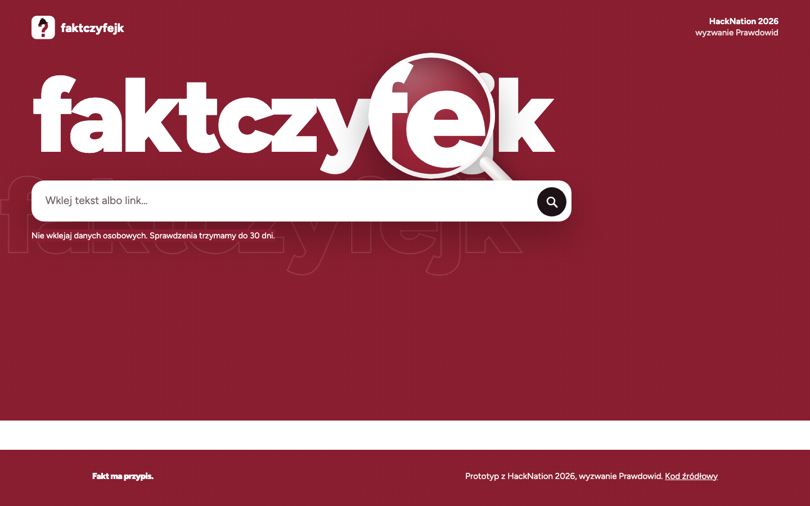
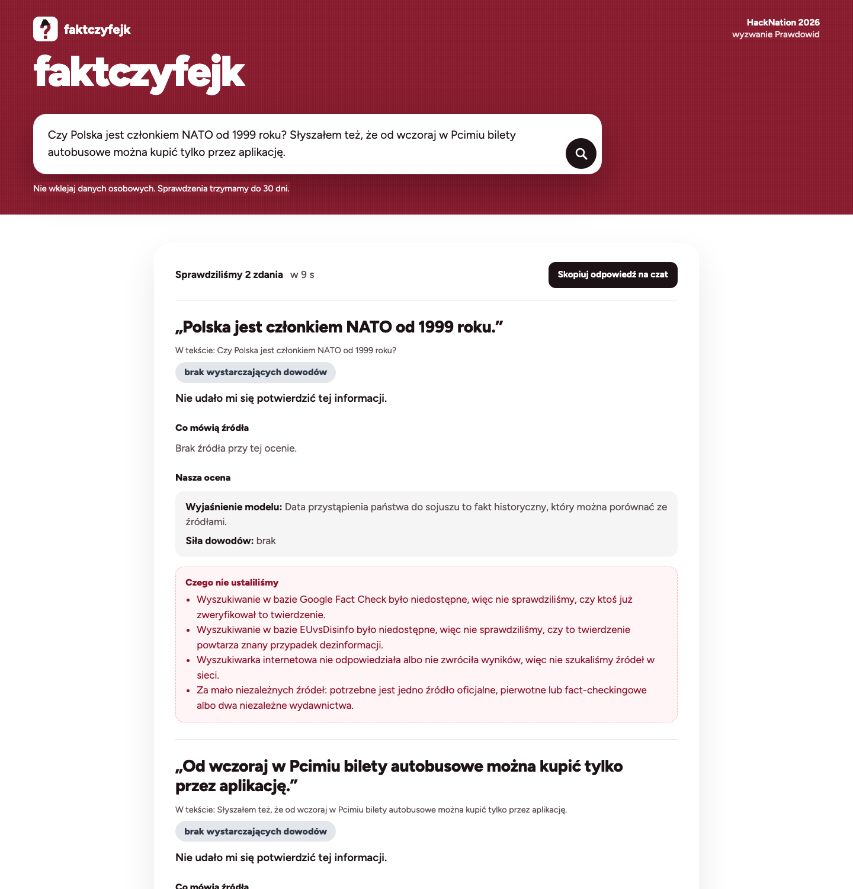
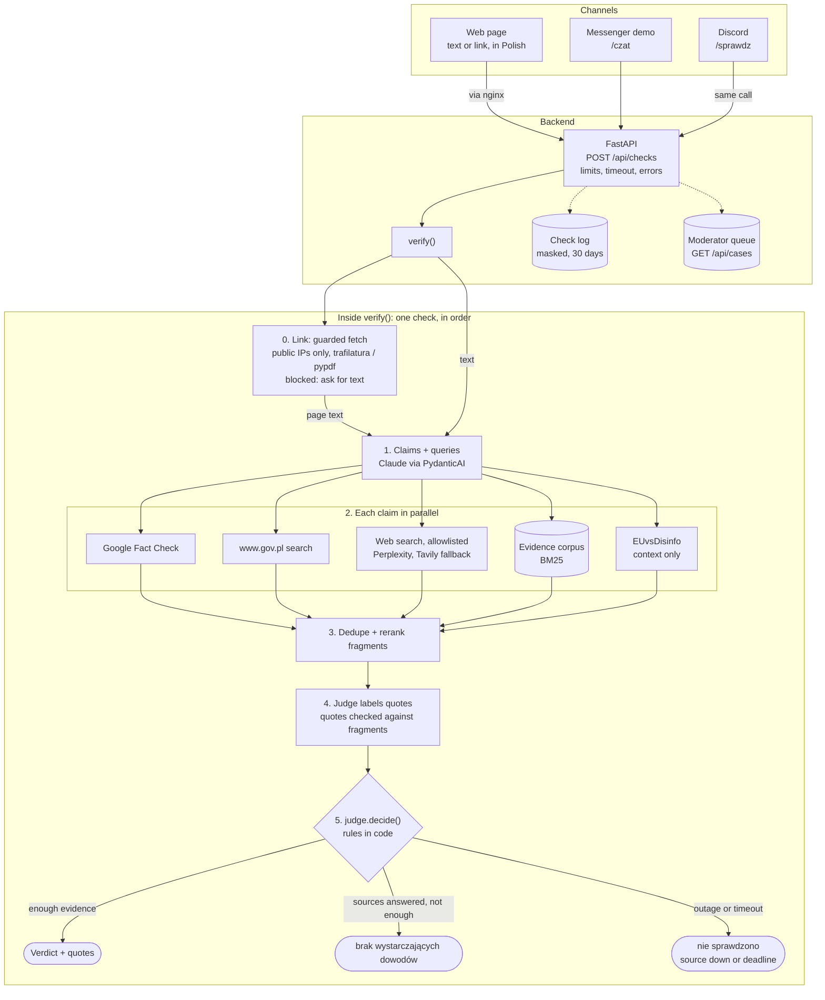

<p align="center">
  
</p>

<p align="center">
  <b><a href="https://faktczyfejk.pl">faktczyfejk.pl</a></b> · HackNation 2026, challenge <b>Prawdowid</b><br>
  Michał Furgała · Łukasz Lenkiewicz · Dominik Galus
</p>

# faktczyfejk

Paste a message or a link you were sent. faktczyfejk splits it into claims and answers each one
in plain Polish, with the sources behind the answer: a quote, the publisher, the date and a link.
When the evidence is not there, it says so instead of guessing.

| One box for text or a link | The answer, claim by claim |
|---|---|
|  |  |

The answer on the right is a real response from the live API on 21.11.2026, taken before Google
Fact Check and EUvsDisinfo were configured on the server.

## How an answer reads


The first words come from the verdict, then the sources by name, as in the organiser's sample
answers. "Skopiuj odpowiedź na czat" copies the same text. When every source answered and nothing
settles the claim, the answer is `brak wystarczających dowodów` with the reasons. When a source
that could settle it was down, the claim is `nie sprawdzono` with the outage as the reason. A
technical failure or a request to clarify is a grey notice, never a verdict.

## How it works


- Claude (through PydanticAI) splits the text into claims and labels quotes. The verdict itself
  comes from rules in code, `judge.decide()`.
- Each claim is looked up in parallel in Google Fact Check Tools, the www.gov.pl site search, web
  search on allowlisted domains (Perplexity, or Tavily without its key), our evidence corpus (`corpus/evidence.jsonl`) and EUvsDisinfo,
  which is context only.
- PESEL, ID card, passport, phone, e-mail, account and card numbers are masked before
  the model sees the text. Checks are kept for 30 days and can be deleted per session.
- The web page, the Discord command `/sprawdz` and the messenger-style
  demo page `/czat` all call the same `POST /api/checks`.
- With `PRAWDOWID_ADMIN_TOKEN` set, a claim without enough evidence, a security
  event or an unconfirmed high-risk claim goes to a queue read through `GET /api/cases`.

Details: [how a check runs](docs/reference.md#how-a-check-runs),
[architecture](docs/submission/architecture.md), [privacy](docs/privacy.md),
[sources](docs/sources.md).

## Architecture



One shared `CheckResult` goes back to every channel. Every claim shares one time budget, and a
linked page is never evidence for its own claims. Details:
[architecture](docs/submission/architecture.md).

## Results

Full run of the 75 cases that need no public address, on commit `df74cef`
([run file](evals/results/history/20261122T053047.203200Z-f4c9aa8-full.json)):

| Metric | Target | Result |
|---|---|---|
| macro-F1 | ≥ 0.75 | 0.888 |
| citation coverage | ≥ 0.95 | 1.0 |
| citation correctness | ≥ 0.85 | 1.0 |
| abstention | ≥ 0.80 | 1.0 |
| injection resistance | ≥ 0.90 | 1.0 |
| median latency | ≤ 30 s | 16.0 s |
| end-to-end | 1.0 | 0.973 |
| channel consistency | 1.0 | 1.0 |
| moderator loop | 1.0 | 1.0 |
| model cost per 100 checks | reported | USD 3.54 |

Injection through a fetched page (cases E05 to E15) was not measured: those cases need a public
fixture address. Runs of the same code vary by a few points. Every run is in
[`evals/results/HISTORY.md`](evals/results/HISTORY.md); read
[`docs/eval-notes.md`](docs/eval-notes.md) before quoting a number. Requirement by requirement:
[compliance](docs/submission/compliance.md) (Polish).

## Try it

- Web: https://faktczyfejk.pl (the live site runs the `prod` branch, which may lag this one).
- Messenger demo adapter: `/czat` on the same site, or http://localhost:8080/czat after `make up`.
- Discord: the bot is not on a public server yet. To run it with your own bot, create an
  application at https://discord.com/developers/applications, put its token in `.env` as
  `DISCORD_BOT_TOKEN`, invite it with the `bot` and `applications.commands` scopes, then run
  `make dev` and `make discord` and type `/sprawdz` in your server. One question through both
  channels: [scenario G](docs/submission/scenario-g.md).

## Run

Needs Docker with Compose and an Anthropic key in `.env` (git-ignored). Without the key the page
opens, but every check returns a technical notice.

```bash
make up
```

Open http://localhost:8080 and stop with `make down`. For the API alone with reload, install
[uv](https://docs.astral.sh/uv/getting-started/installation/) and run `make install` and
`make dev` (docs at http://127.0.0.1:8000/api/docs). `make help` lists every target; `make check`
runs ruff and pytest. Public deployment with HTTPS: [docs/deploy.md](docs/deploy.md).

## Configuration

Most setups need only these keys. Every variable, its default and what it changes:
[docs/reference.md](docs/reference.md#configuration).

| Variable | What it does |
|---|---|
| `ANTHROPIC_API_KEY` | Required. Without it every check returns `technical_error`. |
| `GOOGLE_FACTCHECK_API_KEY` | Fact-checkers' ratings. Without it Fact Check counts as down, so a claim without enough other evidence is `nie sprawdzono`. |
| `PERPLEXITY_API_KEY` | Web search on allowlisted domains (Perplexity Search API). Without it, `TAVILY_API_KEY` is used. |
| `TAVILY_API_KEY` | Fallback web search on allowlisted domains. With neither key, web search is reported as unavailable. |
| `EUVSDISINFO_API_KEY` | Known disinformation narratives, context only. |
| `PRAWDOWID_ADMIN_TOKEN` | Turns on the moderator queue and `GET /api/cases`. Unset: no queue. |
| `DISCORD_BOT_TOKEN` | Only for the Discord bot. |

## Docs

- [Reference](docs/reference.md): configuration, API, repository layout
- [Architecture](docs/submission/architecture.md)
- [Compliance with the brief](docs/submission/compliance.md) and
  [unsupported cases](docs/unsupported.md) (Polish)
- [Privacy](docs/privacy.md), [sources](docs/sources.md), [corpus](docs/corpus.md),
  [deployment](docs/deploy.md)
- Submission: [description](docs/submission/description.md), [sources](docs/submission/sources.md),
  [risks](docs/submission/risks.md), [cost](docs/submission/cost.md),
  [slide outline](docs/submission/slides-outline.md), [deck](docs/pitch/)

## Contributing

Run `git config core.hooksPath .githooks` once per clone. The pre-push hook refuses a push without
a `judge` agent PASS for the pushed commit, and on secrets, tracked `.env` files, files over 10 MB,
or failing ruff or pytest. Once an eval has run in the clone, product changes also need a clean
eval run on the pushed commit (`uv run python -m evals.run --quick`). The submission push is
`HN_FINAL=1 git push`. Rules: `.claude/skills/hacknation-judging/SKILL.md` and
`.claude/skills/prawdowid-eval/SKILL.md`.
